# Camunda 8: End-to-End Workflow Automation (Labs 1-3)

**Name:** Shruti Narang
**Register No:** RA2411003010659
**Assignment:** PBJ-2 Practical Assignment, Labs 1-3

This repository contains three working business processes built with Camunda 8: a loan approval, an online order, and a hospital appointment. Each one was deployed and tested on a real Camunda 8.8 cluster. All data is synthetic.

| Lab | Workflow | Tests passed | Details |
|---|---|---|---|
| 1 | Loan Approval | 8 / 8 | [Lab 1 report](lab1-loan-approval/README.md) |
| 2 | Order Processing and Fulfilment | 8 / 8 | [Lab 2 report](lab2-order-fulfilment/README.md) |
| 3 | Hospital Appointment and Triage | 7 / 7 | [Lab 3 report](lab3-hospital-triage/README.md) |

**23 of 23 test scenarios passed.** This page explains everything with screenshots. Each lab report adds the full process-variable dictionary, REST configuration and limitations.

## Contents

- [Key ideas](#key-ideas)
- [How the parts work together](#how-the-parts-work-together)
- [Lab 1: Loan Approval](#lab-1-loan-approval)
- [Lab 2: Order Processing and Fulfilment](#lab-2-order-processing-and-fulfilment)
- [Lab 3: Hospital Appointment and Triage](#lab-3-hospital-appointment-and-triage)
- [How to run it](#how-to-run-it)
- [Repository layout](#repository-layout)
- [Submission checklist](#submission-checklist)

## Key ideas

| Term | What it means here |
|---|---|
| **BPMN** | The flowchart of the process. Camunda runs this diagram directly. |
| **DMN** | A decision table. Business rules live here instead of in code, so they are easy to read and change. |
| **Process variables** | The data an instance carries from step to step, such as a credit score. |
| **Job worker** | A Java program that does the custom work for a task. It asks Camunda for jobs, does them and sends back the result. |
| **REST Connector** | A ready-made Camunda task that calls a web API, set up in the model without writing code. |
| **Gateway** | A decision point in the diagram that picks which path to take. |
| **Tasklist** | The screen where people complete human tasks. |
| **Operate** | The screen for monitoring running processes and fixing problems. |
| **Incident** | A problem Camunda could not get past by itself, such as a job that ran out of retries. The instance waits until someone fixes it. |

## How the parts work together

All three labs have the same structure:

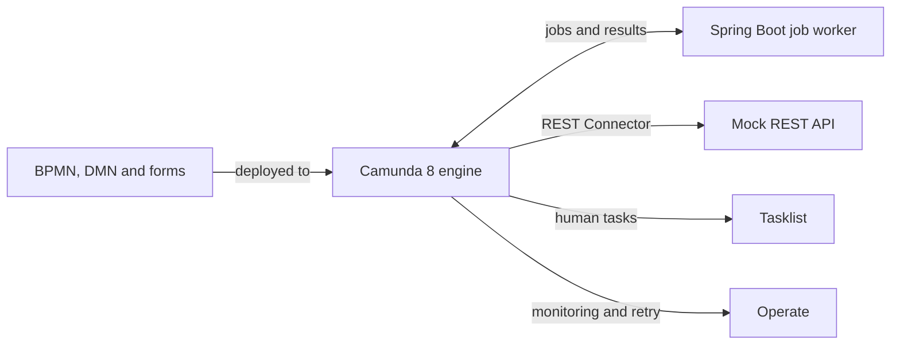

Business outcomes and technical failures are treated differently:

- **A business outcome**, such as a rejected loan or a declined payment, is a normal result. A gateway routes it to the right end.
- **A technical failure**, such as a service being down, is retried automatically. If it keeps failing, it is either sent to a person by a boundary event or raised as an incident to fix and retry.

---

## Lab 1: Loan Approval

**Goal:** decide a loan application automatically where possible, and involve a loan officer only when needed.

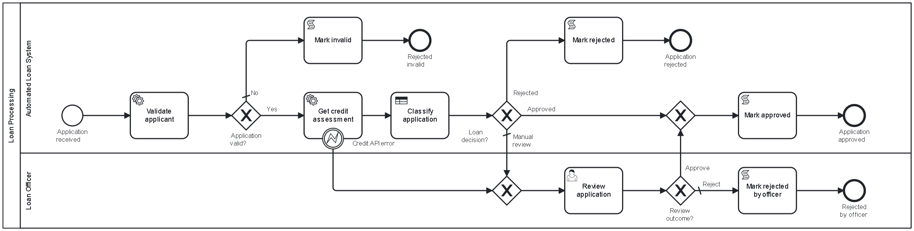

### How it works

1. **Application received.** The process starts with the applicant's details.
2. **Validate applicant** is a Spring Boot job worker. It checks the age, income and loan amount, and works out the loan as a multiple of annual income.
3. **Application valid?** Invalid applications end as *Rejected invalid*.
4. **Get credit assessment** is a REST Connector calling a mock credit API, which returns a score.
5. **Classify application** is a DMN decision that answers Approved, Rejected or Manual Review.
6. **Loan decision?** routes on that answer. Manual Review goes to the **Review application** task in Tasklist.
7. The application ends as approved, rejected, or rejected by the officer.

If the credit API fails or times out, the **Credit API error** boundary event sends the application to the officer, so a service problem does not stop the application.

### Decision rules

The first matching rule wins.

| Credit score | Loan / annual income | Decision | Why |
|---|---|---|---|
| below 600 | any | Rejected | Weak credit |
| any | above 5 | Rejected | Too large for the income |
| 720 or more | 3 or less | Approved | Strong credit, affordable loan |
| any | any | Manual Review | Borderline, so a person decides |

### Test results

| ID | Scenario | Input | Expected route | Final status | Result |
|---|---|---|---|---|---|
| TC1 | Meets approval criteria | APP-GOOD, score 780, ratio 0.52 | Validate, credit check, DMN Approved | APPROVED | ✅ PASS |
| TC2 | Fails eligibility criteria | APP-LOW, score 540 | Validate, credit check, DMN Rejected | REJECTED | ✅ PASS |
| TC3 | Manual review, officer approves | APP-MID, score 680 | DMN Manual Review, officer approves | APPROVED | ✅ PASS |
| TC4 | Manual review, officer rejects | APP-MID, score 680 | DMN Manual Review, officer rejects | REJECTED_BY_OFFICER | ✅ PASS |
| TC5 | Invalid application | age 16 | Validation fails | REJECTED_INVALID | ✅ PASS |
| TC6 | Credit API error | APP-503, API returns 503 | Error boundary event, officer review | APPROVED | ✅ PASS |
| TC7 | Credit API timeout | APP-SLOW, API slower than 3 s timeout | Error boundary event, officer review | REJECTED_BY_OFFICER | ✅ PASS |
| TC8 | Worker failure and recovery | validator outage switched on | Incident, outage fixed, job retried, DMN Approved | APPROVED | ✅ PASS |

### Screenshots explained

**1. Instances in Operate**

Operate lists every run of the Loan Approval process. A green tick means the instance finished. This shows the process was deployed and run many times with different inputs.

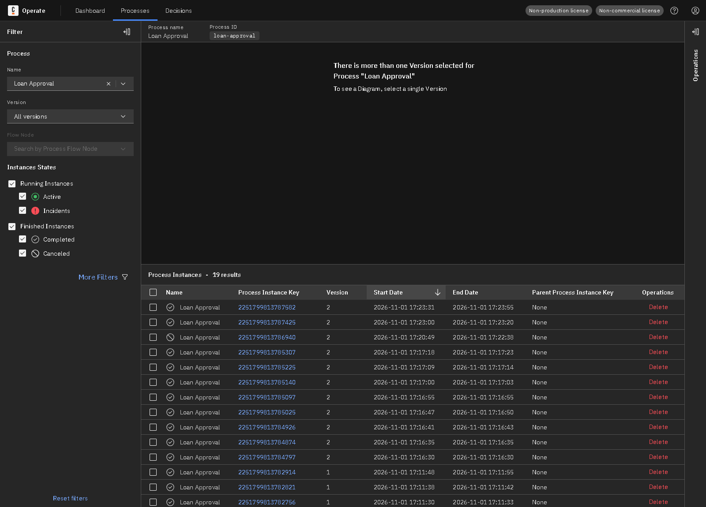

**2. A completed approval**

Test TC1. The blue line is the path this application really took, from start to *Application approved*. The left panel lists each step, and the right panel shows the process variables, such as `creditScore` 780 and `finalStatus` APPROVED.

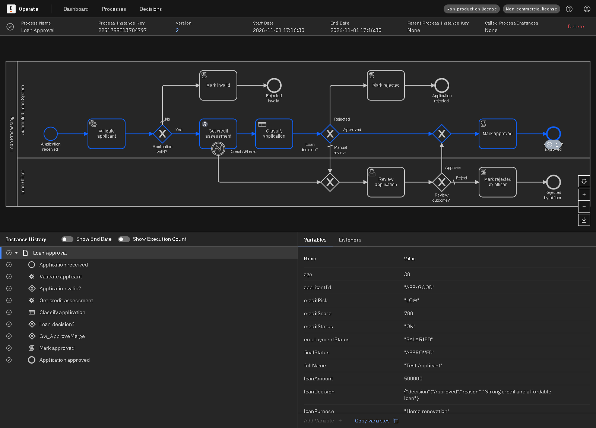

**3. The DMN decision**

Operate shows the decision for that same application. The inputs were a credit score of 780 and a loan-to-income ratio of 0.52, so rule 3 matched (highlighted) and the result was Approved.

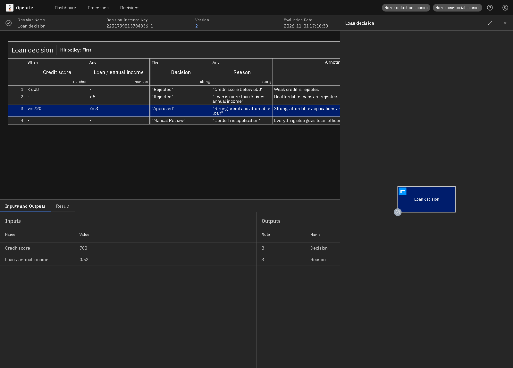

**4. A task waiting in Tasklist**

This application scored in the middle, so DMN chose Manual Review. The process stopped and created *Review application* in the loan officer's Tasklist.

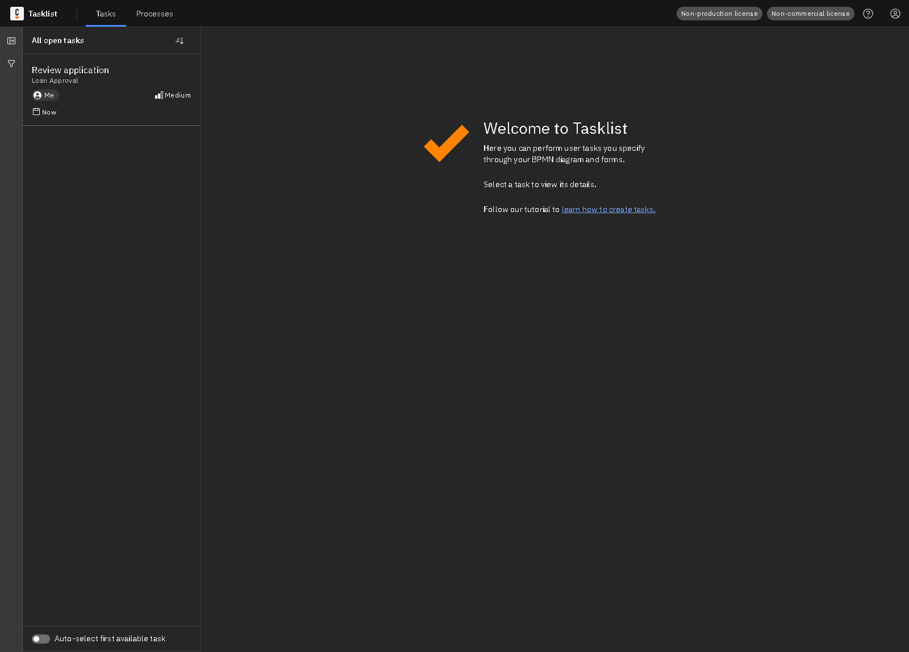

**5. The officer's review form**

The form shows the applicant's details and credit result. The officer picks Approve or Reject and clicks **Complete Task**, and the process continues from there.

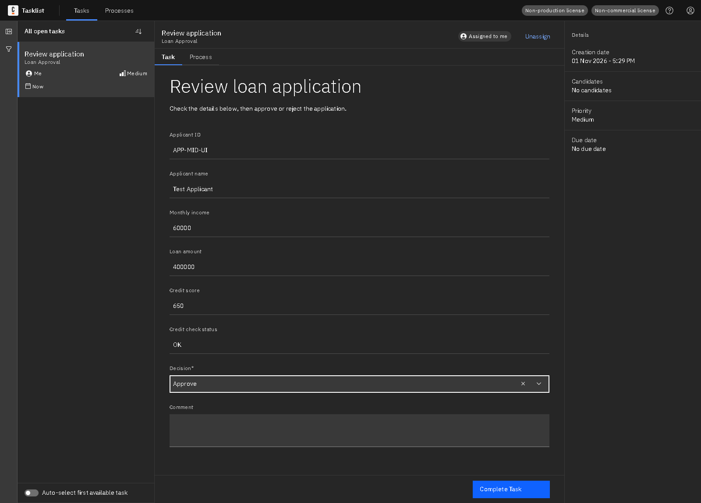

**6. After the review**

The same application in Operate. The blue line now goes through *Review application* and on to approval.

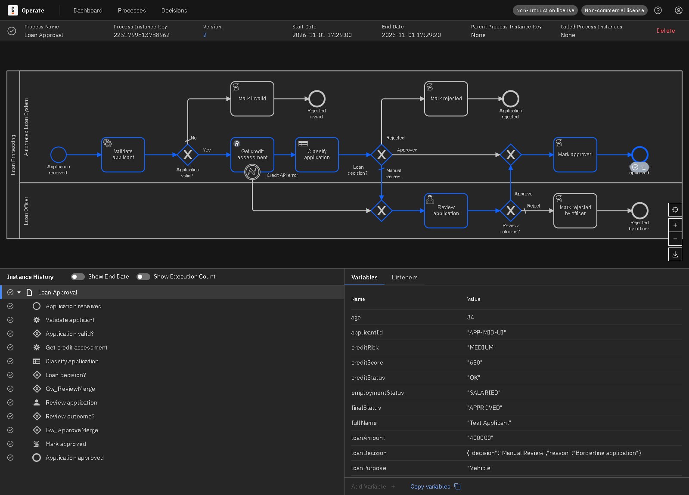

**7. An incident appears**

The validation service was deliberately switched off, so the worker kept failing. Once its 3 retries ran out, Camunda raised an incident. The red mark shows this instance needs attention.

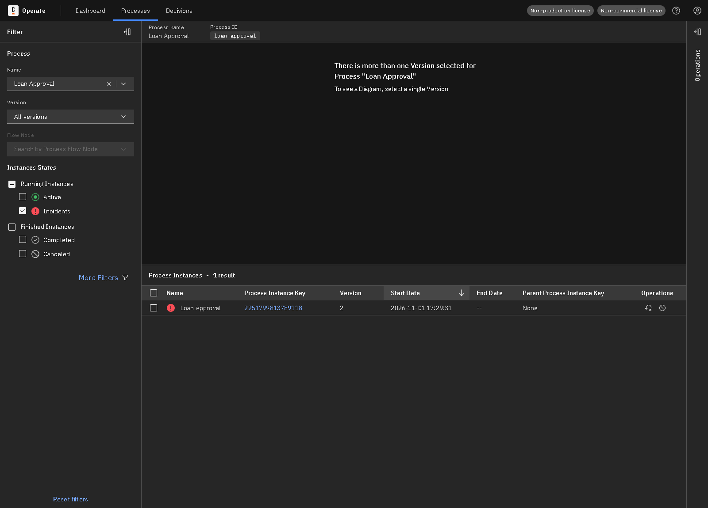

**8. Investigating the incident**

Opening the incident shows what went wrong: *No more retries left* on **Validate applicant**, with the error message from the Java worker. This points to the worker as the cause.

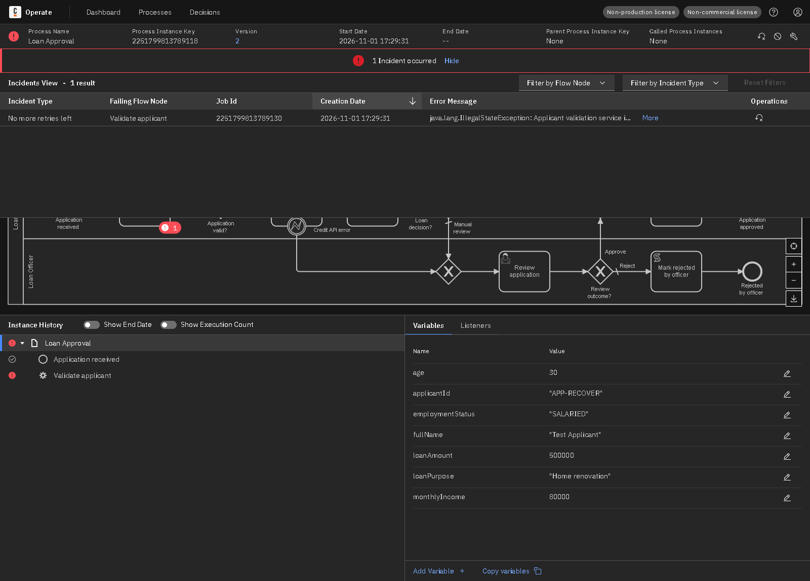

**9. Recovered and finished**

The service was switched back on, then **Retry Instance** was clicked in Operate. The same instance carried on from where it stopped and finished as APPROVED, without starting again.

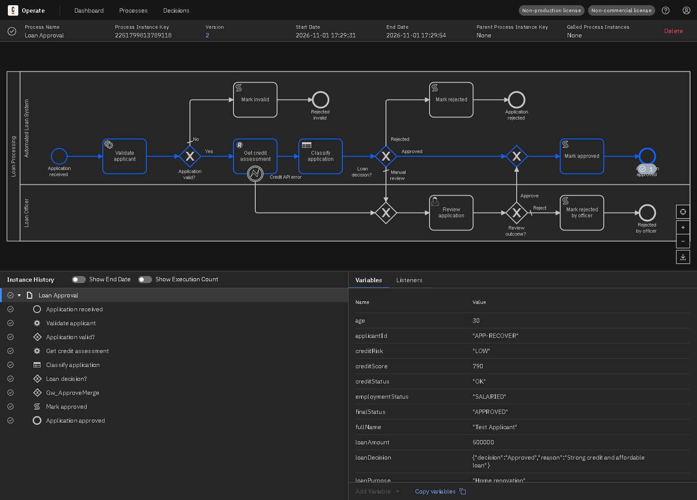

---

## Lab 2: Order Processing and Fulfilment

**Goal:** take an online order from checkout to fulfilment, stopping safely if stock, payment or verification fails.

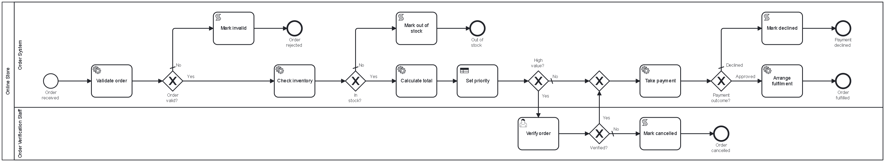

### How it works

1. **Order received.** The process starts with the customer, product, quantity, delivery preference and a test payment token.
2. **Validate order**, **Check inventory** and **Calculate total** are Spring Boot job workers.
3. **In stock?** Orders without enough stock end as *Out of stock*.
4. **Set priority** is a DMN decision that gives the delivery priority.
5. **High value?** Orders of 50,000 or more go to the **Verify order** task in Tasklist before payment.
6. **Take payment** is a REST Connector calling a mock payment service. No real payment details are used.
7. **Payment outcome?** Approved orders go to **Arrange fulfilment**, and declined orders end as *Payment declined*.

### Decision rules

The first matching rule wins. High-value verification is a separate gateway in the process.

| Order value | Customer | Delivery | Priority |
|---|---|---|---|
| any | any | EXPRESS | Critical |
| 50,000 or more | any | any | High |
| any | PREMIUM | any | High |
| 10,000 to under 50,000 | any | any | Medium |
| any | any | any | Low |

### Test results

| ID | Scenario | Input | Expected route | Final status | Result |
|---|---|---|---|---|---|
| TC1 | Stock available, payment succeeds | SKU-1001 x 2, tok_test_ok | Stock OK, payment approved, fulfilment | FULFILLED | ✅ PASS |
| TC2 | Insufficient stock | SKU-3003 x 2, 0 in stock | Stock gateway: not available | OUT_OF_STOCK | ✅ PASS |
| TC3 | Payment declined | SKU-1001 x 2, tok_declined | Payment gateway: declined | PAYMENT_DECLINED | ✅ PASS |
| TC4 | High-value order verified | SKU-2002 x 1, total 75000 | Manual verification, payment, fulfilment | FULFILLED | ✅ PASS |
| TC5 | High-value order cancelled | SKU-2002 x 1, total 75000 | Manual verification, cancelled | CANCELLED_BY_STAFF | ✅ PASS |
| TC6 | Invalid order | quantity 0 | Validation fails | REJECTED_INVALID | ✅ PASS |
| TC7 | Payment service failure and recovery | payment outage switched on | Incident, outage fixed, job retried, fulfilment | FULFILLED | ✅ PASS |
| TC8 | Inventory worker failure and recovery | inventory outage switched on | Incident, outage fixed, job retried, fulfilment | FULFILLED | ✅ PASS |

### Screenshots explained

**1. Instances in Operate**

Every run of the Order Processing process, showing it was deployed and tested with many orders.


**2. A fulfilled order**

Test TC1. The blue line follows validation, stock check, total, priority, payment and fulfilment. The variables show the data passed between steps, such as `stockStatus` and `paymentStatus`.


**3. The DMN priority decision**

The order value, customer category and delivery preference go in, and the matched rule gives the delivery priority.

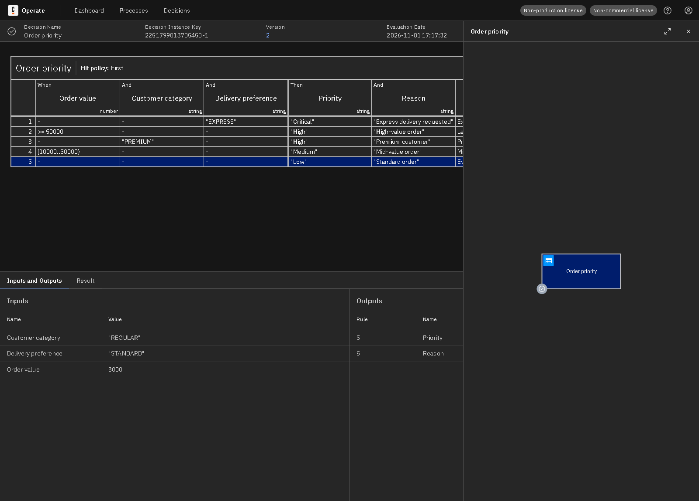

**4. A high-value order waiting**

This order is 75,000, which is over the 50,000 limit, so *Verify order* was created in Tasklist before any payment is taken.


**5. The verification form**

Staff see the order, its total and its High priority. They choose to verify or cancel it, then click **Complete Task**.

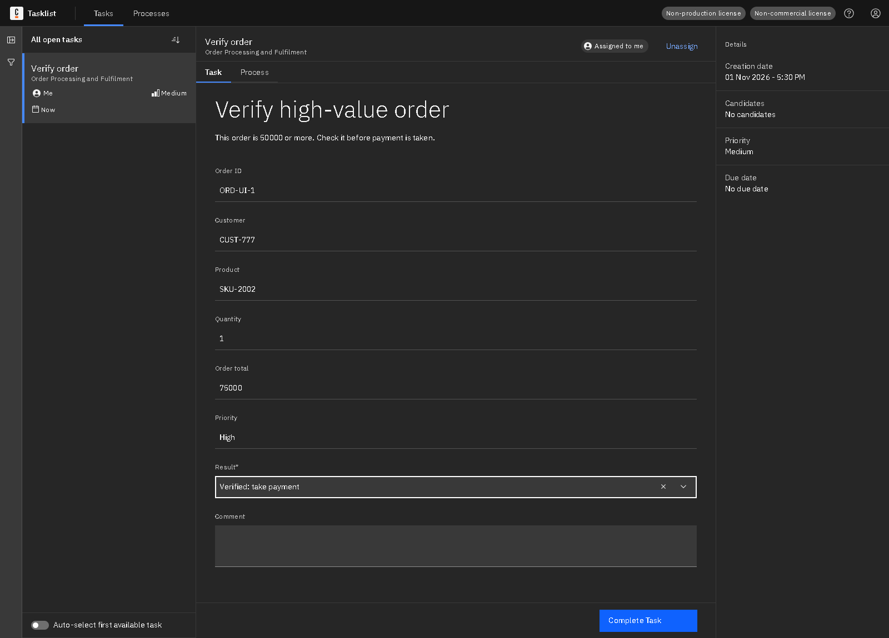

**6. After verification**

The order went through *Verify order*, then payment and fulfilment, and ended as FULFILLED.

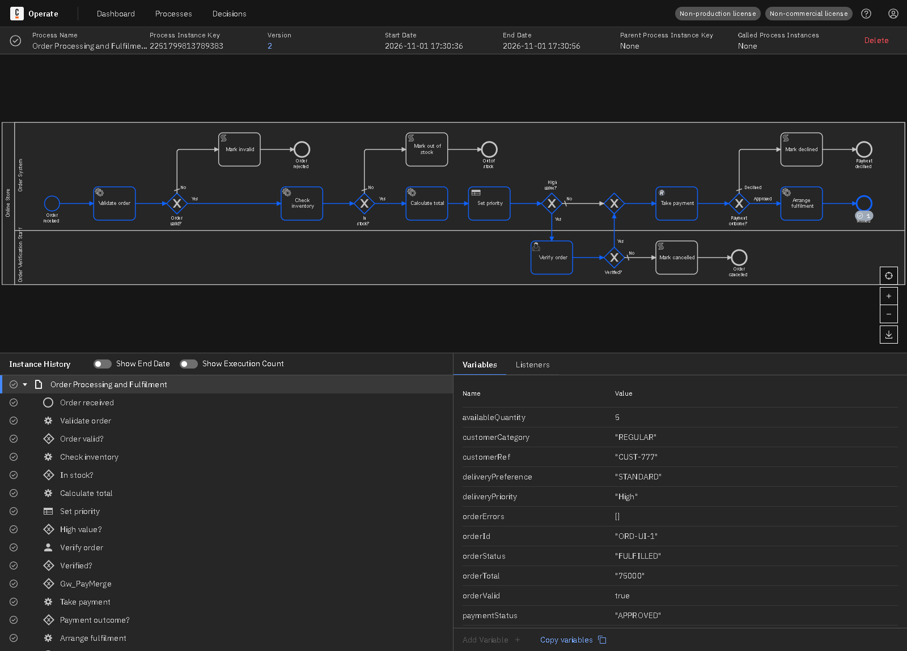

**7. An incident appears**

The mock payment service was switched off, so it returned HTTP 503. The REST Connector retried 3 times and then Camunda raised an incident.


**8. Investigating the incident**

The incident is on **Take payment**. The error contains the API's response, *Payment service unavailable*, so the cause is the payment service and not the process.

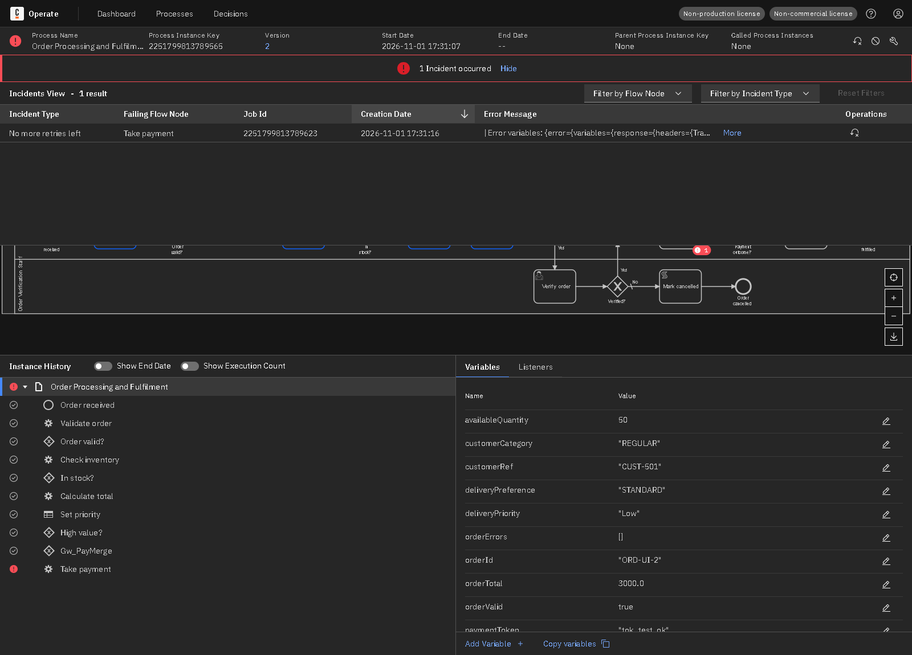

**9. Recovered and finished**

The service was switched back on and the instance was retried from Operate. Payment was taken and the order finished as FULFILLED.

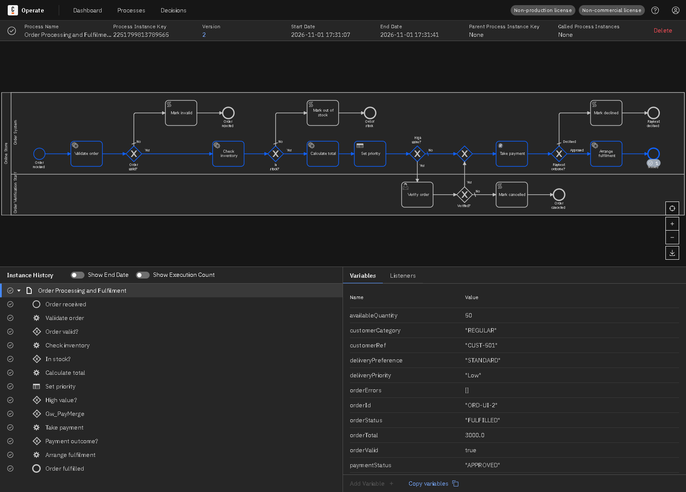

---

## Lab 3: Hospital Appointment and Triage

**Goal:** register a patient, sort the request by urgency, and either book a slot or pass the case to staff.

> This is an educational simulation with synthetic patients. The triage rules were invented for this lab and are not clinical guidance.

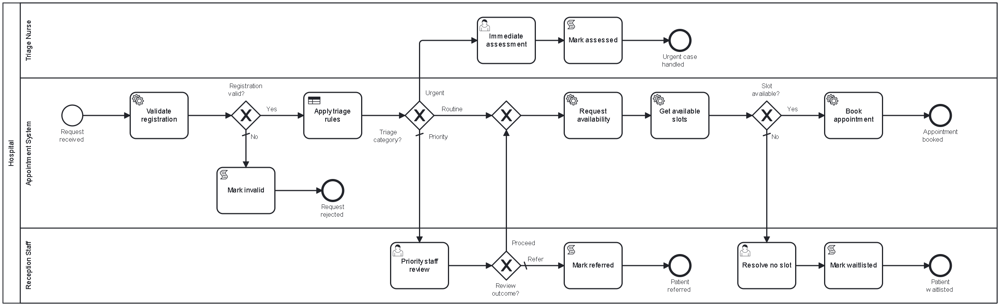

### How it works

1. **Request received.** The process starts with a synthetic patient reference, preferences, a symptoms summary and urgency indicators.
2. **Validate registration** is a Spring Boot job worker that checks the fields.
3. **Apply triage rules** is a DMN decision that answers Routine, Priority Review or Urgent Assessment.
4. **Triage category?** routes the request:
   - **Urgent** goes straight to **Immediate assessment** by the triage nurse.
   - **Priority** goes to **Priority staff review**, where staff proceed or refer the patient.
   - **Routine** goes directly to the slot check.
5. **Request availability** is a job worker that prepares the request, and **Get available slots** is a REST Connector calling the mock scheduling API.
6. **Slot available?** If yes, **Book appointment** books the best slot. If no, **Resolve no slot** asks staff to decide, and the patient is waitlisted.

### Decision rules

The first matching rule wins.

| Red-flag symptom | Pain level | Symptom days | Category |
|---|---|---|---|
| yes | any | any | Urgent Assessment |
| any | 8 or more | any | Urgent Assessment |
| any | 5 to 7 | any | Priority Review |
| any | any | more than 14 | Priority Review |
| any | any | any | Routine |

### Test results

| ID | Scenario | Input | Expected route | Final status | Result |
|---|---|---|---|---|---|
| TC1 | Routine with a slot | pain 2, cardiology | DMN Routine, slot found, booked | CONFIRMED | ✅ PASS |
| TC2 | Priority review, staff proceed | pain 6 | DMN Priority Review, staff proceed, booked | CONFIRMED | ✅ PASS |
| TC3 | Priority review, staff refer | 14+ days of symptoms | DMN Priority Review, staff refer | REFERRED_BY_STAFF | ✅ PASS |
| TC4 | Urgent assessment | red-flag symptom | DMN Urgent Assessment, immediate human task | URGENT_ASSESSED | ✅ PASS |
| TC5 | No slots available | dermatology, no slots | No slot, staff task, waitlisted | WAITLISTED | ✅ PASS |
| TC6 | Invalid registration | bad patient reference | Validation fails | INVALID_REGISTRATION | ✅ PASS |
| TC7 | Scheduling API failure and recovery | scheduling outage switched on | Incident, outage fixed, job retried, booked | CONFIRMED | ✅ PASS |

### Screenshots explained

**1. Instances in Operate**

Every run of the Hospital Appointment process, showing it was tested with many synthetic patients.

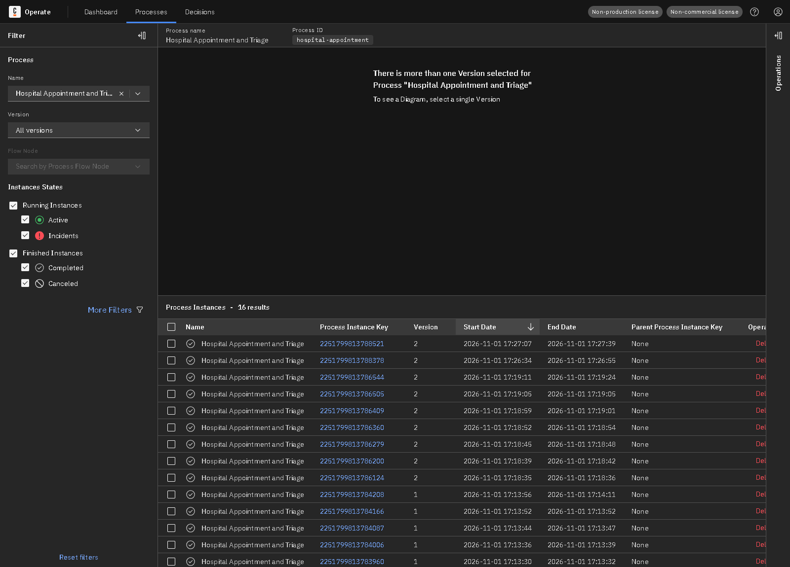

**2. A booked routine appointment**

Test TC1. The blue line follows validation, triage, slot check and booking, and ends at *Appointment booked*.


**3. The DMN triage decision**

The urgency indicators go in, and the highlighted rule gives the category. This patient had no urgency indicators, so the result is Routine.

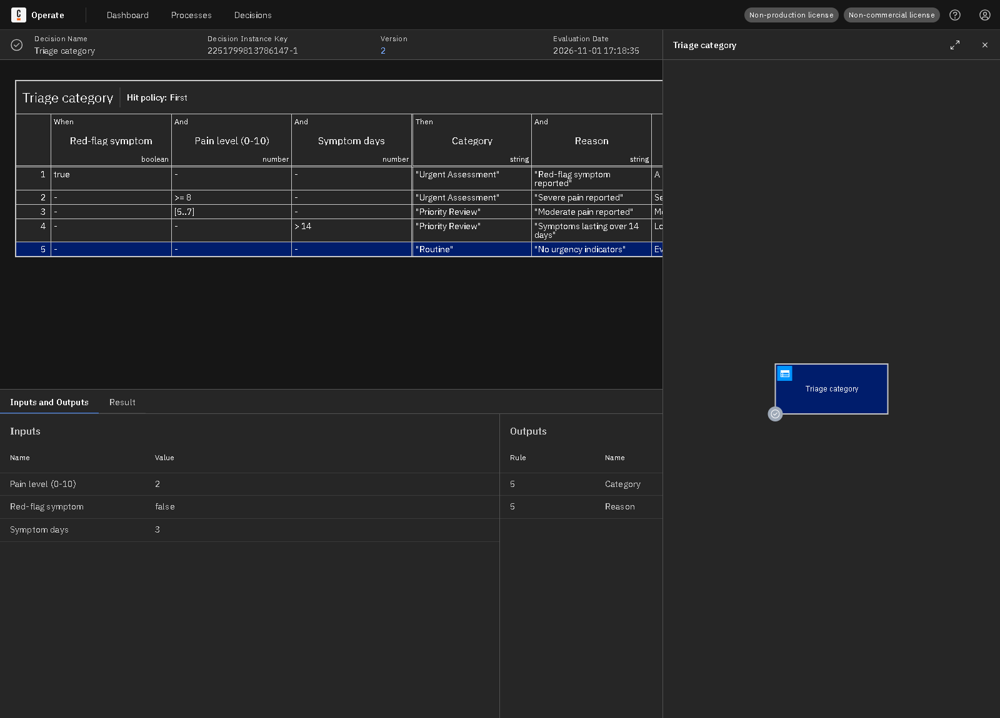

**4. A case waiting for staff**

This patient reported pain level 6, so DMN chose Priority Review and *Priority staff review* appeared in Tasklist.


**5. The staff review form**

Staff see the synthetic patient reference and symptoms summary, then choose to proceed to booking or refer the patient elsewhere.

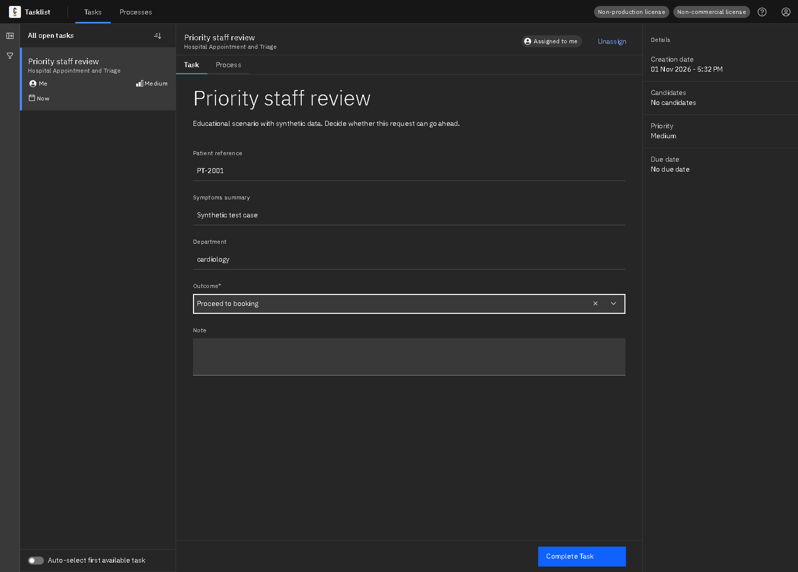

**6. After the review**

Staff chose to proceed, so the process went back to the normal slot check and booked the appointment.

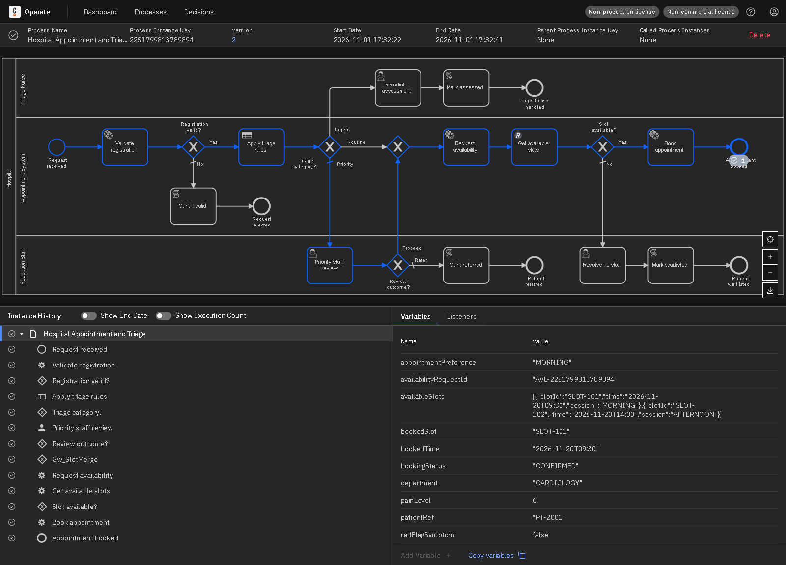

**7. An incident appears**

The mock scheduling API was switched off, so it returned HTTP 503. The REST Connector retried 3 times and then Camunda raised an incident.

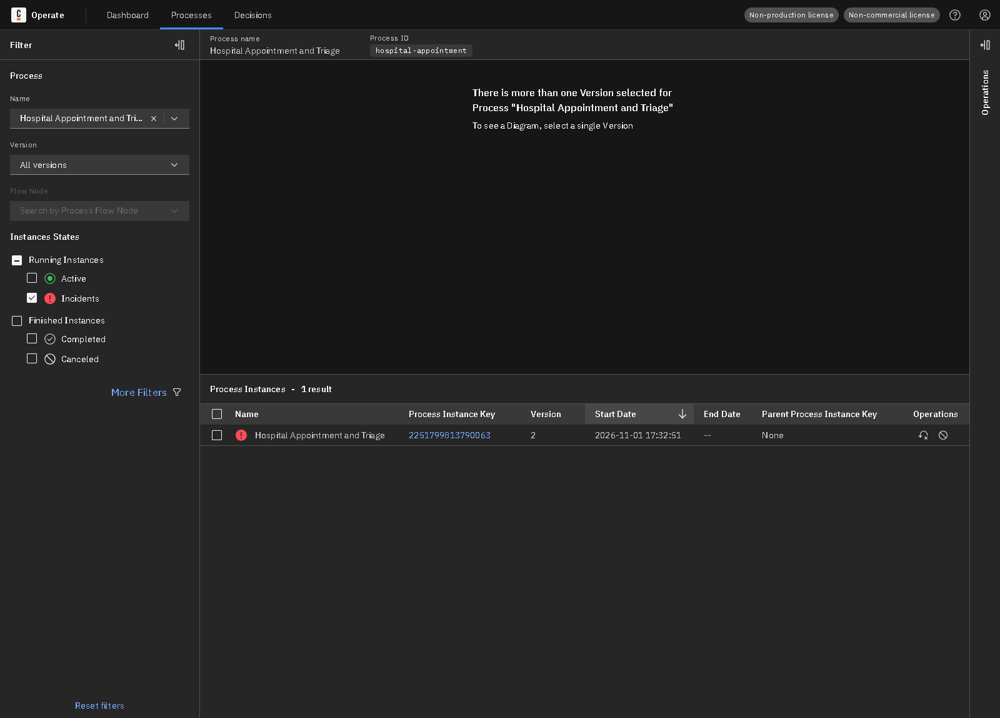

**8. Investigating the incident**

The incident is on **Get available slots**, and the error contains the API's response, *Scheduling service unavailable*.

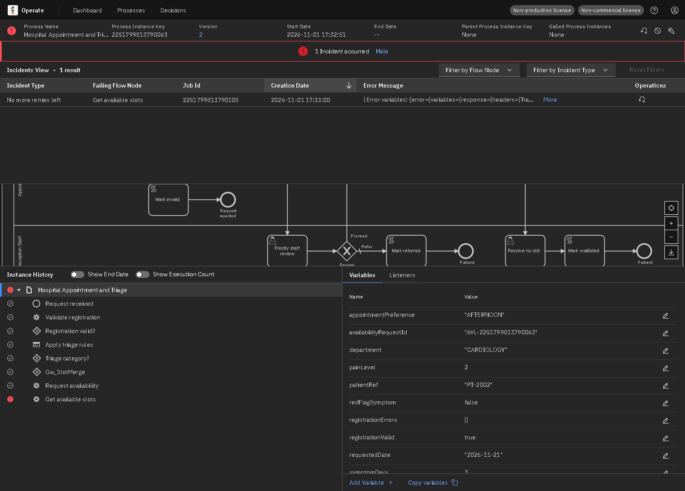

**9. Recovered and finished**

The API was switched back on and the instance was retried from Operate. It fetched the slots, booked the afternoon slot the patient preferred, and finished as CONFIRMED.

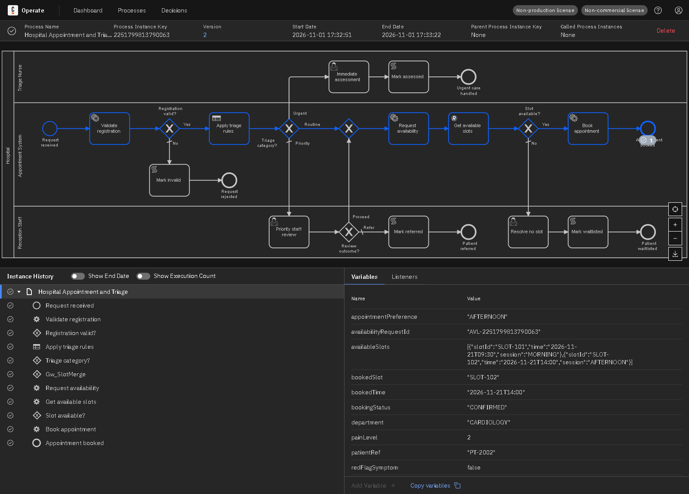

---

## How to run it

**You need:** Java 17 or newer, [Camunda 8 Run](https://docs.camunda.io/docs/self-managed/quickstart/developer-quickstart/c8run/) 8.8 and Node.js 18 or newer. Camunda Modeler is needed only to open the models. Maven does not need installing, because each worker includes the Maven Wrapper.

```bash
# 1. Start Camunda 8 Run from its install folder (on Windows PowerShell: .\c8run.exe start)
./c8run start

# 2. Start a lab's worker and mock API (on Windows PowerShell use .\mvnw.cmd)
cd lab1-loan-approval/worker
./mvnw spring-boot:run

# 3. In a new terminal, from the repository root, deploy and run every test
node tools/run-scenarios.js lab1-loan-approval
```

Use `lab2-order-fulfilment` or `lab3-hospital-triage` for the other labs. Lab 1 uses port 8101, Lab 2 uses 8102 and Lab 3 uses 8103, so all three workers can run together.

Open Operate at <http://localhost:8080/operate> and Tasklist at <http://localhost:8080/tasklist>. The local login is `demo` / `demo`.

## Repository layout

```text
.
├── lab1-loan-approval/
│   ├── models/         BPMN, DMN and form files
│   ├── worker/         Spring Boot job worker and mock API
│   ├── api-examples/   REST request and response samples
│   ├── tests/          Test scenarios
│   └── evidence/       Screenshots and recorded results
├── lab2-order-fulfilment/   (same layout)
├── lab3-hospital-triage/    (same layout)
└── tools/run-scenarios.js   Deploys a lab and runs its scenarios
```

## Submission checklist

| Item | Where to find it |
|---|---|
| BPMN models and screenshots | `models/*.bpmn` and the diagrams above |
| DMN models, rules and sample results | `models/*.dmn`, the rules above, and each lab report |
| Job worker source and run instructions | `worker/` and [How to run it](#how-to-run-it) |
| REST Connector configuration and API examples | Each lab report and `api-examples/` |
| Process-variable dictionary | Each lab report |
| Test cases: success, rejection, manual review, failure and recovery | The test tables above and `tests/scenarios.json` |
| Deployment and execution evidence | Screenshots 1 and 2 of each lab, and `evidence/test-results.json` |
| Tasklist evidence | Screenshots 4 and 5 of each lab |
| Operate monitoring and incident evidence | Screenshots 6 to 9 of each lab |
| Report: architecture, flow, results, limitations | This page and each lab report |
