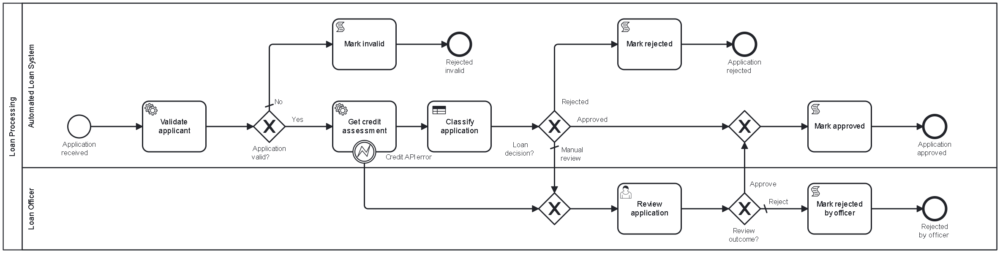
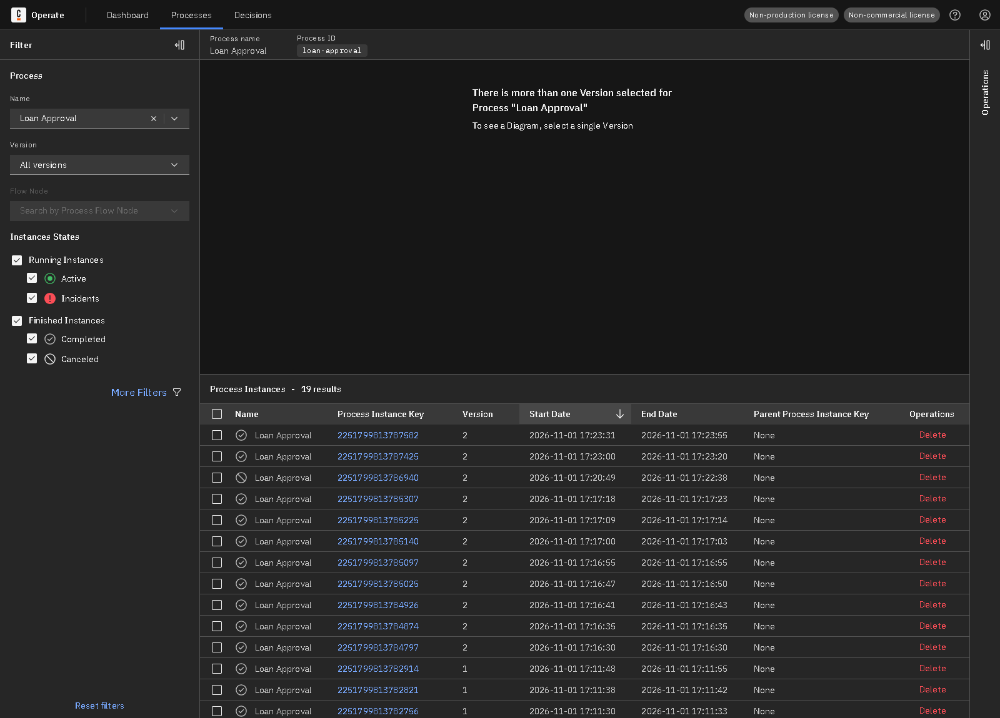
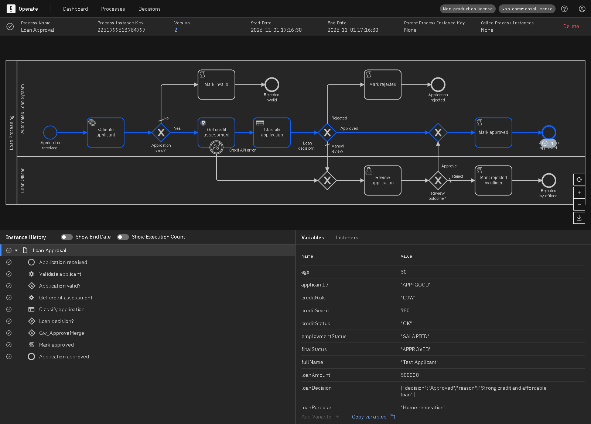
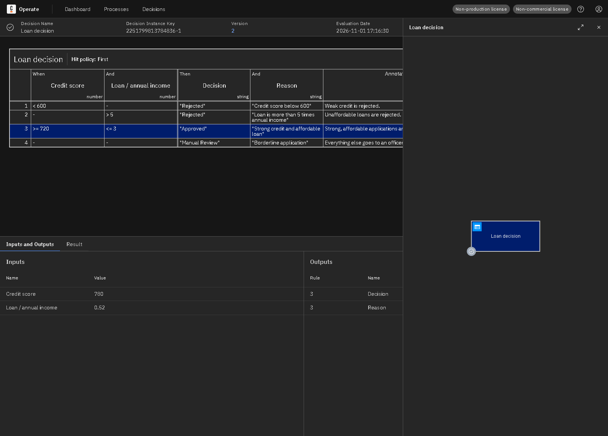
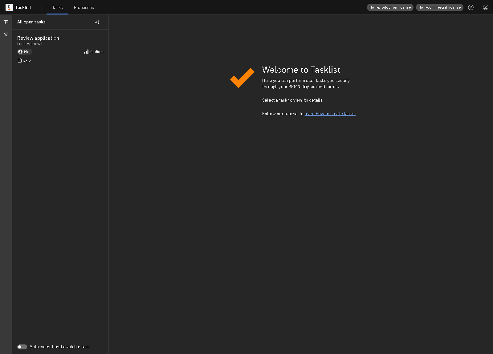
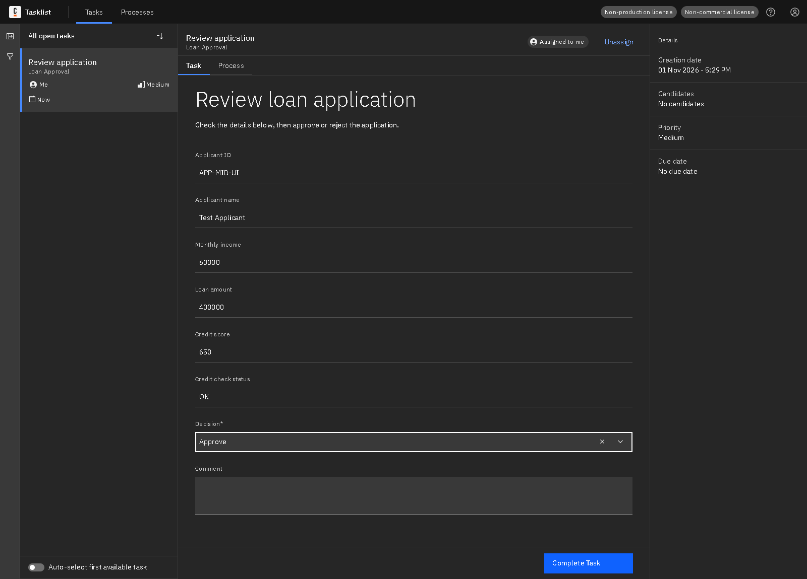
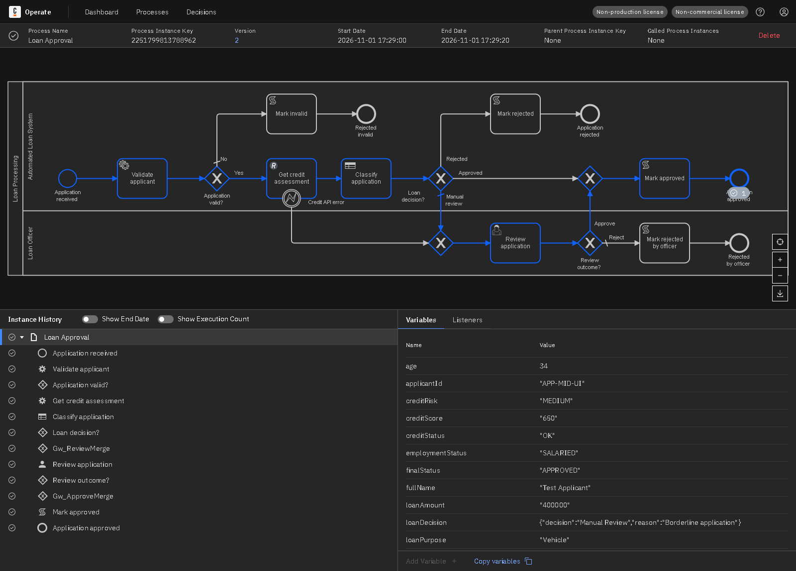
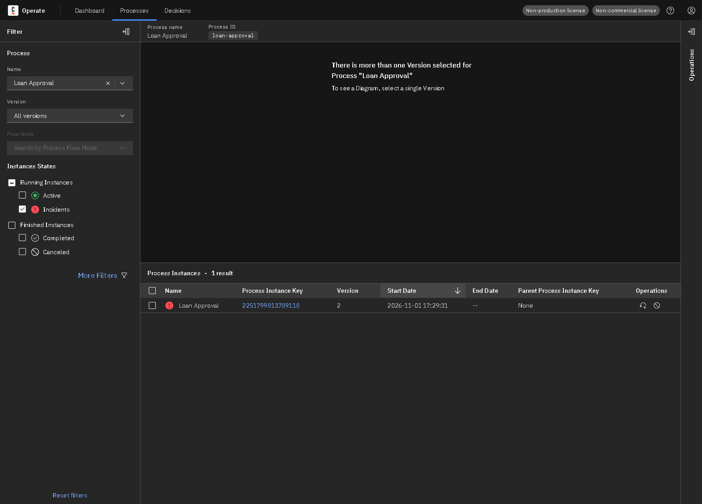
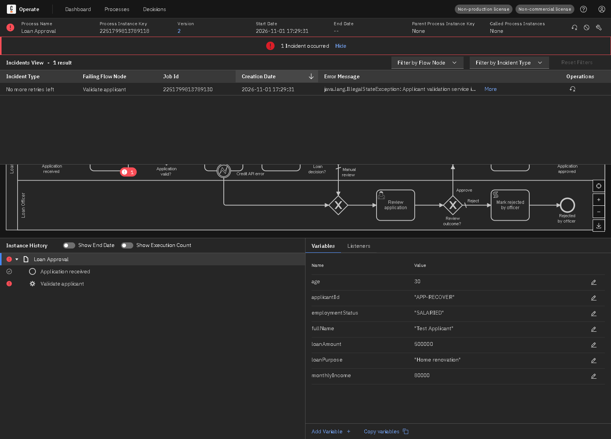
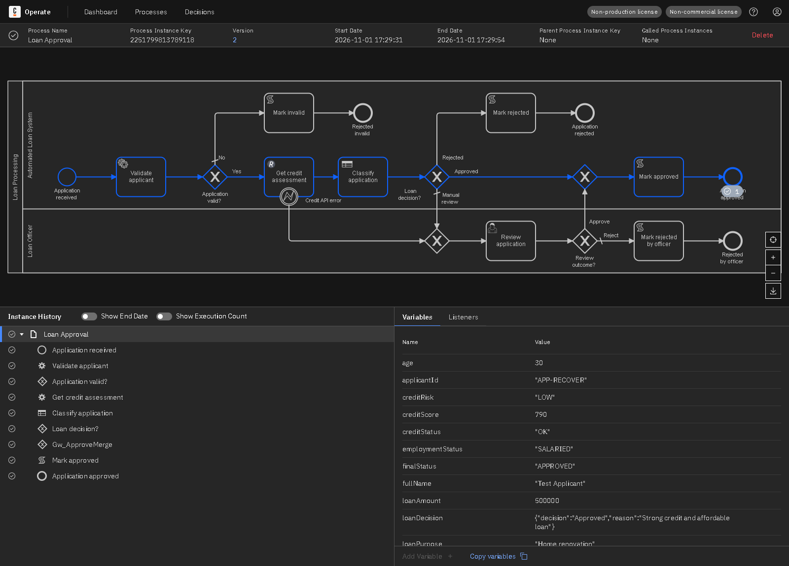

# Lab 1: End-to-End Loan Approval Automation

A loan application is validated by a Spring Boot worker, assessed by a mock credit API through the REST Connector, classified by a DMN table, and then approved, rejected or sent to a loan officer in Tasklist.

## Contents

| Path | What it is |
|---|---|
| `models/loan-approval.bpmn` | BPMN process (id `loan-approval`) |
| `models/loan-decision.dmn` | DMN decision (id `loan-decision`) |
| `models/loan-review-form.form` | Tasklist form for the officer |
| `worker/` | Spring Boot job worker and mock REST API |
| `api-examples/` | REST request and response samples |
| `tests/scenarios.json` | Test inputs and expected results |
| `evidence/` | Screenshots and recorded test results |

## Architecture

Start → **Validate applicant** (job worker) → **Get credit assessment** (REST Connector) → **Classify application** (DMN) → gateway → Approved, Rejected, or **Review application** (Tasklist).

| Part | Technology |
|---|---|
| Process engine, Tasklist, Operate | Camunda 8.8 (Camunda 8 Run) |
| Models | BPMN 2.0, DMN and Camunda forms, made for Camunda Modeler |
| External job worker | Java 17+, Spring Boot 3.5, Camunda Spring Boot Starter 8.8 |
| Service integration | REST Connector calling a mock API on port 8101 |



## Gateway routing

| Gateway | Condition | Routing |
|---|---|---|
| Application valid? | `validationPassed = true` | Yes: credit check. No (default): rejected as invalid. |
| Loan decision? | `loanDecision.decision` | Approved: approve. Rejected: reject. Anything else (default): manual review, so an unexpected result reaches a person. |
| Review outcome? | `reviewDecision = "APPROVE"` | Approve: approved. Otherwise (default): rejected by officer. |

## DMN decision

Hit policy **First**: the first matching rule from the top wins.

| Credit score | Loan / annual income | Decision | Reason |
|---|---|---|---|
| < 600 | - | Rejected | Credit score below 600 |
| - | > 5 | Rejected | Loan is more than 5 times annual income |
| >= 720 | <= 3 | Approved | Strong credit and affordable loan |
| - | - | Manual Review | Borderline application |

Sample evaluations, returned by the deployed decision through the Camunda REST API:

| Input | Output |
|---|---|
| creditScore=540, loanToAnnualIncome=1 | decision: Rejected, reason: Credit score below 600 |
| creditScore=780, loanToAnnualIncome=6 | decision: Rejected, reason: Loan is more than 5 times annual income |
| creditScore=780, loanToAnnualIncome=0.52 | decision: Approved, reason: Strong credit and affordable loan |
| creditScore=680, loanToAnnualIncome=0.52 | decision: Manual Review, reason: Borderline application |

## Job worker

| Job type | BPMN task | What it does |
|---|---|---|
| `lab1.validate-applicant` | Validate applicant | Checks ID, name, age 18-70, income above 0, loan 10,000 to 5,000,000. Returns the validation result and the loan-to-annual-income ratio. Throws during a simulated outage. |

## REST Connector

`POST http://localhost:8101/api/credit/assess`, 3 second connect and read timeouts.

| Setting | Value |
|---|---|
| Job type | `io.camunda:http-json:1` (REST Connector) |
| Body | `={applicantId: applicantId, monthlyIncome: monthlyIncome, loanAmount: loanAmount}` |
| Result expression | `={creditScore: response.body.score, creditRisk: response.body.risk, creditStatus: "OK"}` |
| Error expression | `=if is defined(error) then bpmnError("CREDIT_API_ERROR", error.message) else null` |

The error expression turns an API error or timeout into the BPMN error `CREDIT_API_ERROR`. An error boundary event catches it, and the application goes to the officer instead of stopping.

Sample responses are in [`api-examples/`](api-examples/README.md).

## Process variables

| Name | Type | Set by | Purpose |
|---|---|---|---|
| applicantId | String | Start | Applicant reference, also picks the mock credit result |
| fullName | String | Start | Applicant name |
| age | Number | Start | Applicant age |
| monthlyIncome | Number | Start | Monthly income |
| loanAmount | Number | Start | Requested amount |
| loanPurpose | String | Start | Purpose of the loan |
| employmentStatus | String | Start | Employment type |
| validationPassed | Boolean | Worker | Whether the application is valid |
| validationErrors | List | Worker | Validation problems found |
| loanToAnnualIncome | Number | Worker | Loan divided by annual income, a DMN input |
| creditScore | Number | REST Connector | Score from the credit API, a DMN input |
| creditRisk | String | REST Connector | LOW, MEDIUM or HIGH |
| creditStatus | String | REST Connector / boundary event | OK, or UNAVAILABLE after an API error |
| loanDecision | Object | DMN | `decision` and `reason` |
| reviewDecision | String | Tasklist | APPROVE or REJECT |
| reviewComment | String | Tasklist | Officer comment |
| finalStatus | String | Script task | Final outcome of the application |

## How to run

1. Start Camunda 8 Run from its install folder: `./c8run start` (on Windows PowerShell: `.\c8run.exe start`)
2. Start the worker and mock API:

   ```bash
   cd lab1-loan-approval/worker
   ./mvnw spring-boot:run
   ```

   On Windows PowerShell use `.\mvnw.cmd spring-boot:run`.
3. From the repository root, deploy the models and run every scenario:

   ```bash
   node tools/run-scenarios.js lab1-loan-approval
   ```

To start one instance by hand, deploy the files in `models/` from Camunda Modeler and use these variables:

```json
{
  "applicantId": "APP-GOOD", "fullName": "Test Applicant", "age": 30,
  "monthlyIncome": 80000, "loanAmount": 500000,
  "loanPurpose": "Home renovation", "employmentStatus": "SALARIED"
}
```

Then open <http://localhost:8080/operate> and <http://localhost:8080/tasklist> (login `demo` / `demo`).

## Test results

**8 of 8 scenarios passed** on Camunda 8.8.32, run on 2026-11-01. `APP-GOOD` scores 780, `APP-RECOVER` 790, `APP-MID` 680, `APP-LOW` 540. `APP-503` returns a server error, and `APP-SLOW` takes 8 seconds, longer than the 3 second timeout.

| ID | Scenario | Input | Expected route | Expected end | Actual end | Final status | Result |
|---|---|---|---|---|---|---|---|
| TC1 | Meets approval criteria | APP-GOOD, score 780, ratio 0.52 | Validate, credit check, DMN Approved | `End_Approved` | `End_Approved` | APPROVED | **PASS** |
| TC2 | Fails eligibility criteria | APP-LOW, score 540 | Validate, credit check, DMN Rejected | `End_Rejected` | `End_Rejected` | REJECTED | **PASS** |
| TC3 | Manual review, officer approves | APP-MID, score 680 | DMN Manual Review, officer approves | `End_Approved` | `End_Approved` | APPROVED | **PASS** |
| TC4 | Manual review, officer rejects | APP-MID, score 680 | DMN Manual Review, officer rejects | `End_OfficerRejected` | `End_OfficerRejected` | REJECTED_BY_OFFICER | **PASS** |
| TC5 | Invalid application | age 16 | Validation fails | `End_Invalid` | `End_Invalid` | REJECTED_INVALID | **PASS** |
| TC6 | Credit API error | APP-503, API returns 503 | Error boundary event, officer review | `End_Approved` | `End_Approved` | APPROVED | **PASS** |
| TC7 | Credit API timeout | APP-SLOW, API slower than 3 s timeout | Error boundary event, officer review | `End_OfficerRejected` | `End_OfficerRejected` | REJECTED_BY_OFFICER | **PASS** |
| TC8 | Worker failure and recovery | validator outage switched on | Incident, outage fixed, job retried, DMN Approved | `End_Approved` | `End_Approved` | APPROVED | **PASS** |

Instance details:

| ID | Process instance key | Steps during the run |
|---|---|---|
| TC1 | 2251799813784797 | Ran with no intervention |
| TC2 | 2251799813784874 | Ran with no intervention |
| TC3 | 2251799813784926 | Completed task Task_Review |
| TC4 | 2251799813785025 | Completed task Task_Review |
| TC5 | 2251799813785097 | Ran with no intervention |
| TC6 | 2251799813785140 | Completed task Task_Review |
| TC7 | 2251799813785225 | Completed task Task_Review |
| TC8 | 2251799813785307 | Incident on Task_Validate: java.lang.IllegalStateException: Applicant validation service i; Cause fixed, job retried |

## Incident investigation and recovery

1. **Cause.** The worker's `validator` outage switch was turned on, so **Validate applicant** threw an exception. Camunda used up the 3 job retries and raised a *No more retries left* incident.
2. **Diagnosis.** Operate showed the incident on the failing task, with this error: `java.lang.IllegalStateException: Applicant validation service is unavailable (simulated outage)`
3. **Fix.** The underlying cause was corrected by turning the outage off:

   `curl -X POST "http://localhost:8101/admin/fault?name=validator&down=false"`
4. **Retry.** The job was retried from Operate with **Retry Instance**, and instance `2251799813789118` carried on and completed.

The automated test does the same steps through the Camunda REST API: it updates the job's retries and resolves the incident.

## Evidence

Screenshots come from this implementation running on a local Camunda 8 Run cluster. The Tasklist and incident screenshots use separate runs from the tests in the table above, with instances `2251799813788962` and `2251799813789118`.

**Operate: deployed process and its instances**



**Operate: completed instance with its path, history and variables**



**Operate: DMN evaluation with the matched rule highlighted**



**Tasklist: human task waiting**



**Tasklist: review form filled in**



**Operate: instance finished after the human task**



**Operate: instance with an active incident**



**Operate: incident details and error message**



**Operate: same instance completed after the fix and retry**



## Report

**Implementation.** The process is modelled in BPMN and each kind of work uses a suitable tool: job workers for custom Java logic, DMN for business rules, the REST Connector for the external API, and user tasks for human decisions. Data moves between activities as process variables.

**Failure handling.** Business outcomes, such as a rejected application, are handled by gateways. Technical failures are retried, and then either routed by a boundary event or raised as an incident that can be fixed and retried.

**Results.** All 8 scenarios finished at the expected end event with the expected final status, including the failure and recovery path.

**Limitations.**

- Credit scores come from a small fixed table, not from a real bureau.
- If the credit API is down, the DMN table is skipped and an officer decides without a score.
- The mock API runs inside the worker app, so it is available only while the worker is running.
- Rules and data are simple and synthetic, made for this lab only.
- No authentication is used, because everything runs locally on Camunda 8 Run.
- Labels in the BPMN file end with a few spaces and an invisible character. This works around a Camunda Modeler 5.50.1 display bug that splits external labels mid-word; it does not change how the process runs.
