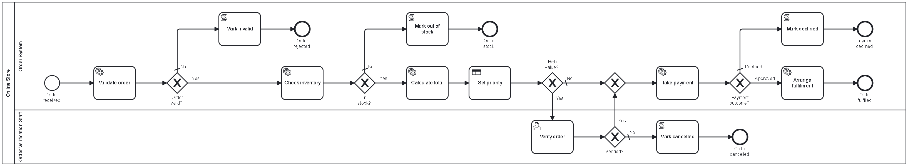
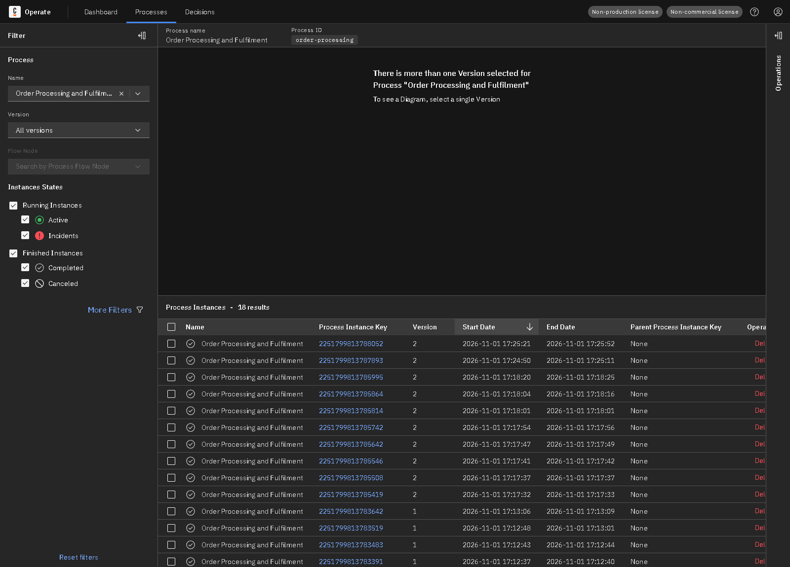
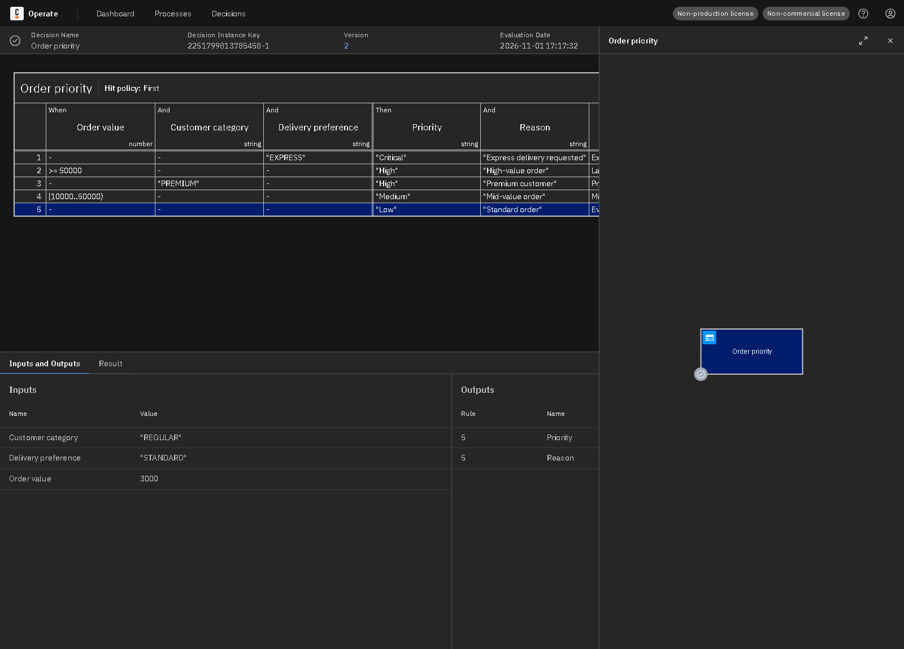
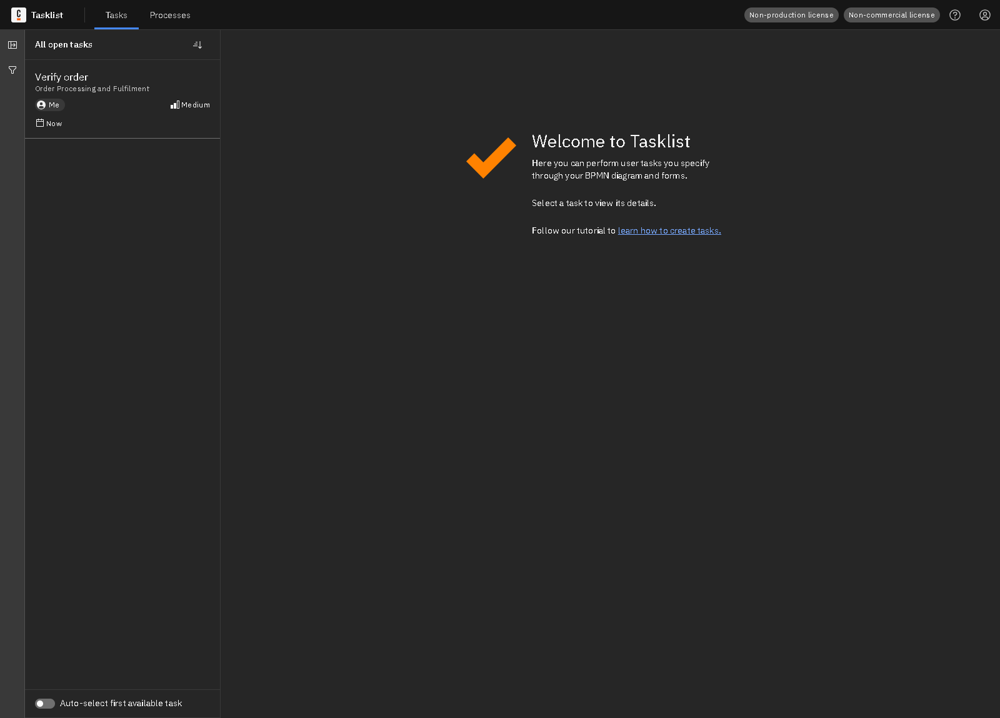
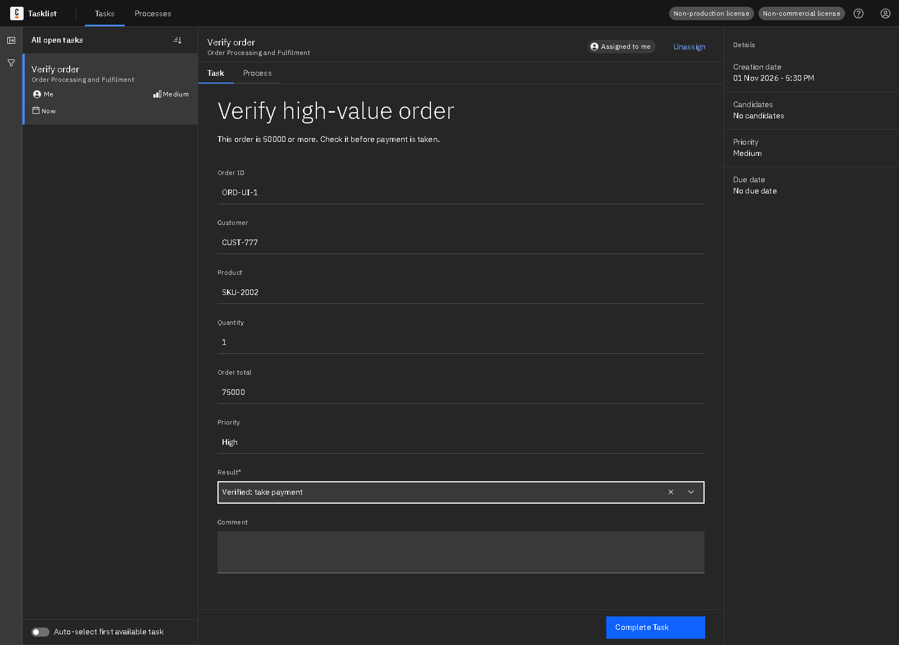
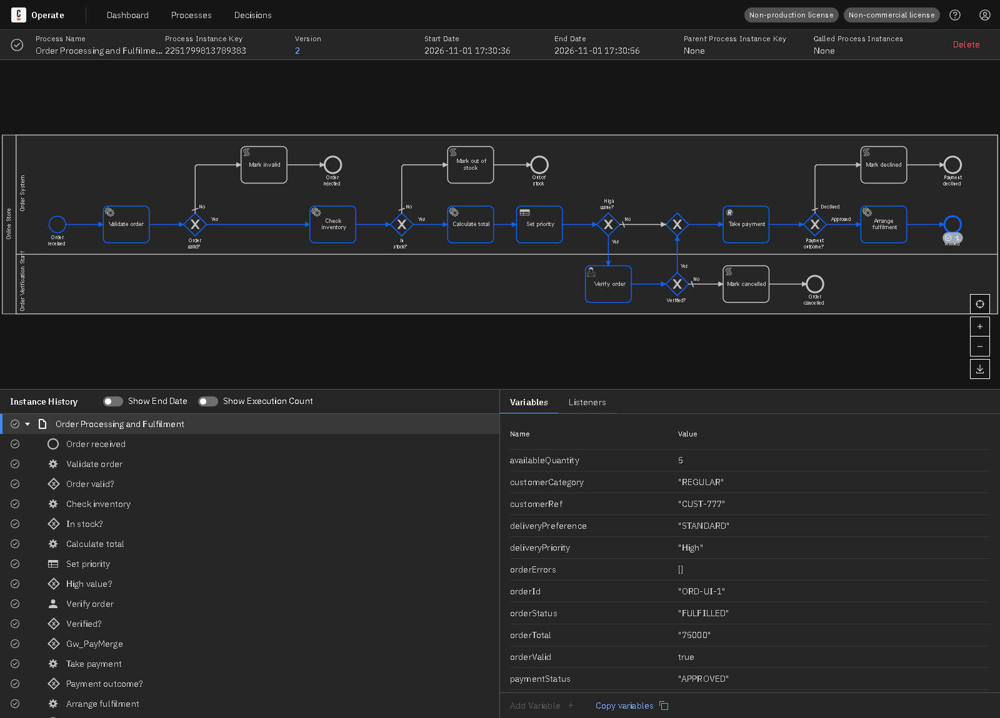
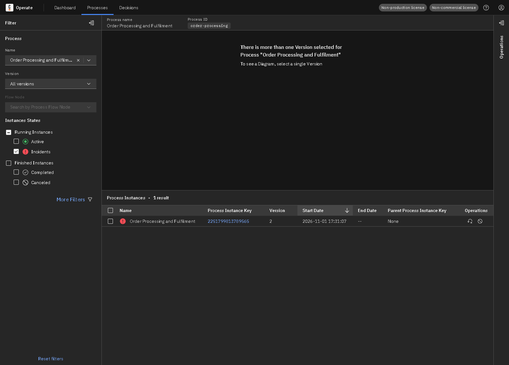
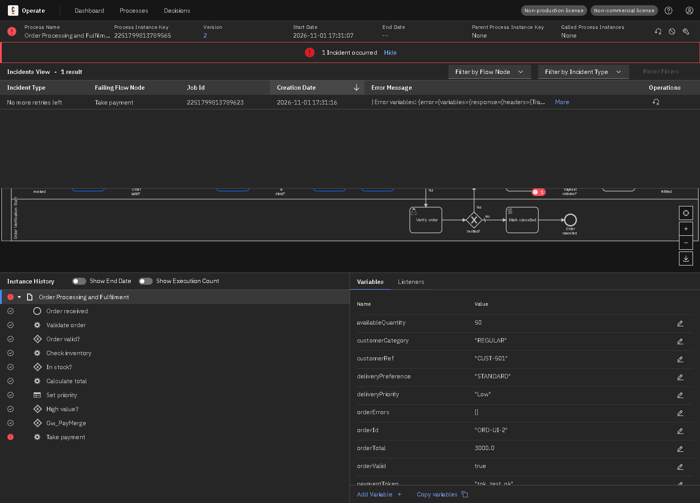
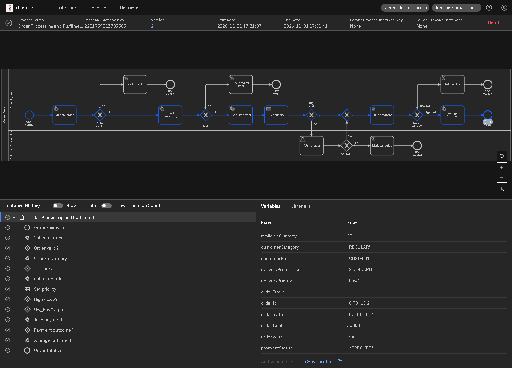

# Lab 2: End-to-End E-Commerce Order Processing and Fulfilment

An order is validated, checked against simulated inventory and totalled by Spring Boot workers, given a delivery priority by DMN, verified by staff if high value, paid through a mock payment service using the REST Connector, and sent to fulfilment.

## Contents

| Path | What it is |
|---|---|
| `models/order-processing.bpmn` | BPMN process (id `order-processing`) |
| `models/order-priority.dmn` | DMN decision (id `order-priority`) |
| `models/order-verification-form.form` | Tasklist form for staff |
| `worker/` | Spring Boot job worker and mock REST API |
| `api-examples/` | REST request and response samples |
| `tests/scenarios.json` | Test inputs and expected results |
| `evidence/` | Screenshots and recorded test results |

## Architecture

Start → **Validate order** → **Check inventory** → **Calculate total** (job workers) → **Set priority** (DMN) → high-value check → **Verify order** (Tasklist, if needed) → **Take payment** (REST Connector) → **Arrange fulfilment** (job worker).

| Part | Technology |
|---|---|
| Process engine, Tasklist, Operate | Camunda 8.8 (Camunda 8 Run) |
| Models | BPMN 2.0, DMN and Camunda forms, made for Camunda Modeler |
| External job worker | Java 17+, Spring Boot 3.5, Camunda Spring Boot Starter 8.8 |
| Service integration | REST Connector calling a mock API on port 8102 |



## Gateway routing

| Gateway | Condition | Routing |
|---|---|---|
| Order valid? | `orderValid = true` | Yes: check stock. No (default): rejected. |
| In stock? | `stockStatus = "AVAILABLE"` | Yes: continue. No (default): out of stock, so it cannot reach fulfilment. |
| High value? | `orderTotal >= 50000` | Yes: manual verification. No (default): go straight to payment. |
| Verified? | `verificationResult = "VERIFIED"` | Yes: payment. No (default): cancelled. |
| Payment outcome? | `paymentStatus = "APPROVED"` | Approved: fulfilment. Otherwise (default): payment declined. |

## DMN decision

Hit policy **First**: the first matching rule from the top wins. The high-value check is a separate gateway, so a priority of High does not by itself trigger review.

| Order value | Customer category | Delivery preference | Priority | Reason |
|---|---|---|---|---|
| - | - | EXPRESS | Critical | Express delivery requested |
| >= 50000 | - | - | High | High-value order |
| - | PREMIUM | - | High | Premium customer |
| [10000..50000) | - | - | Medium | Mid-value order |
| - | - | - | Low | Standard order |

Sample evaluations, returned by the deployed decision through the Camunda REST API:

| Input | Output |
|---|---|
| orderTotal=3000, customerCategory="REGULAR", deliveryPreference="EXPRESS" | priority: Critical, reason: Express delivery requested |
| orderTotal=75000, customerCategory="REGULAR", deliveryPreference="STANDARD" | priority: High, reason: High-value order |
| orderTotal=3000, customerCategory="PREMIUM", deliveryPreference="STANDARD" | priority: High, reason: Premium customer |
| orderTotal=20000, customerCategory="REGULAR", deliveryPreference="STANDARD" | priority: Medium, reason: Mid-value order |
| orderTotal=3000, customerCategory="REGULAR", deliveryPreference="STANDARD" | priority: Low, reason: Standard order |

## Job worker

| Job type | BPMN task | What it does |
|---|---|---|
| `lab2.validate-order` | Validate order | Checks order ID, customer, product, quantity, delivery preference and payment token. |
| `lab2.check-inventory` | Check inventory | Looks up simulated stock and price. Throws during a simulated outage. |
| `lab2.calculate-total` | Calculate total | Unit price x quantity. |
| `lab2.arrange-fulfilment` | Arrange fulfilment | Creates a simulated shipment ID. |

## REST Connector

`POST http://localhost:8102/api/payments`, 5 second connect and read timeouts, 3 retries with a 2 second backoff.

| Setting | Value |
|---|---|
| Job type | `io.camunda:http-json:1` (REST Connector) |
| Body | `={orderId: orderId, amount: orderTotal, paymentToken: paymentToken}` |
| Result expression | `={paymentStatus: response.body.status, transactionId: response.body.transactionId}` |

A declined payment is a normal HTTP 200 result, so the gateway routes it. An HTTP 503 is a technical failure, so the connector retries and then raises an incident.

Sample responses are in [`api-examples/`](api-examples/README.md).

## Process variables

| Name | Type | Set by | Purpose |
|---|---|---|---|
| orderId | String | Start | Order reference |
| customerRef | String | Start | Customer reference |
| productId | String | Start | Product ordered |
| quantity | Number | Start | Units ordered |
| deliveryPreference | String | Start | STANDARD or EXPRESS, a DMN input |
| customerCategory | String | Start | REGULAR or PREMIUM, a DMN input |
| paymentToken | String | Start | Mock payment token |
| orderValid | Boolean | Worker | Whether the order is valid |
| orderErrors | List | Worker | Validation problems found |
| stockStatus | String | Worker | AVAILABLE or INSUFFICIENT |
| availableQuantity | Number | Worker | Units in stock |
| unitPrice | Number | Worker | Price per unit |
| orderTotal | Number | Worker | Total value, a DMN input |
| priorityResult | Object | DMN | `priority` and `reason` |
| deliveryPriority | String | DMN output mapping | Delivery priority |
| verificationResult | String | Tasklist | VERIFIED or CANCELLED |
| verificationComment | String | Tasklist | Staff comment |
| paymentStatus | String | REST Connector | APPROVED or DECLINED |
| transactionId | String | REST Connector | Mock transaction reference |
| shipmentId | String | Worker | Simulated shipment |
| orderStatus | String | Worker / script task | Final outcome of the order |

## How to run

1. Start Camunda 8 Run from its install folder: `./c8run start` (on Windows PowerShell: `.\c8run.exe start`)
2. Start the worker and mock API:

   ```bash
   cd lab2-order-fulfilment/worker
   ./mvnw spring-boot:run
   ```

   On Windows PowerShell use `.\mvnw.cmd spring-boot:run`.
3. From the repository root, deploy the models and run every scenario:

   ```bash
   node tools/run-scenarios.js lab2-order-fulfilment
   ```

To start one instance by hand, deploy the files in `models/` from Camunda Modeler and use these variables:

```json
{
  "orderId": "ORD-1001", "customerRef": "CUST-501", "productId": "SKU-1001", "quantity": 2,
  "deliveryPreference": "STANDARD", "customerCategory": "REGULAR", "paymentToken": "tok_test_ok"
}
```

Then open <http://localhost:8080/operate> and <http://localhost:8080/tasklist> (login `demo` / `demo`).

## Test results

**8 of 8 scenarios passed** on Camunda 8.8.32, run on 2026-11-01. Products: `SKU-1001` (1,500, 50 in stock), `SKU-2002` (75,000, 5 in stock), `SKU-3003` (2,500, none in stock), `SKU-4004` (300, 200 in stock). Token `tok_declined` is declined and any other test token is approved. No real payment details are used.

| ID | Scenario | Input | Expected route | Expected end | Actual end | Final status | Result |
|---|---|---|---|---|---|---|---|
| TC1 | Stock available, payment succeeds | SKU-1001 x 2, tok_test_ok | Stock OK, payment approved, fulfilment | `End_Fulfilled` | `End_Fulfilled` | FULFILLED | **PASS** |
| TC2 | Insufficient stock | SKU-3003 x 2, 0 in stock | Stock gateway: not available | `End_NoStock` | `End_NoStock` | OUT_OF_STOCK | **PASS** |
| TC3 | Payment declined | SKU-1001 x 2, tok_declined | Payment gateway: declined | `End_Declined` | `End_Declined` | PAYMENT_DECLINED | **PASS** |
| TC4 | High-value order verified | SKU-2002 x 1, total 75000 | Manual verification, payment, fulfilment | `End_Fulfilled` | `End_Fulfilled` | FULFILLED | **PASS** |
| TC5 | High-value order cancelled | SKU-2002 x 1, total 75000 | Manual verification, cancelled | `End_Cancelled` | `End_Cancelled` | CANCELLED_BY_STAFF | **PASS** |
| TC6 | Invalid order | quantity 0 | Validation fails | `End_Invalid` | `End_Invalid` | REJECTED_INVALID | **PASS** |
| TC7 | Payment service failure and recovery | payment outage switched on | Incident, outage fixed, job retried, fulfilment | `End_Fulfilled` | `End_Fulfilled` | FULFILLED | **PASS** |
| TC8 | Inventory worker failure and recovery | inventory outage switched on | Incident, outage fixed, job retried, fulfilment | `End_Fulfilled` | `End_Fulfilled` | FULFILLED | **PASS** |

Instance details:

| ID | Process instance key | Steps during the run |
|---|---|---|
| TC1 | 2251799813785419 | Ran with no intervention |
| TC2 | 2251799813785508 | Ran with no intervention |
| TC3 | 2251799813785546 | Ran with no intervention |
| TC4 | 2251799813785642 | Completed task Task_Verify |
| TC5 | 2251799813785742 | Completed task Task_Verify |
| TC6 | 2251799813785814 | Ran with no intervention |
| TC7 | 2251799813785864 | Incident on Task_Payment: \| Error variables: {error={variables={response={headers={Transfe; Cause fixed, job retried |
| TC8 | 2251799813785995 | Incident on Task_Stock: java.lang.IllegalStateException: Inventory service is unavailable ; Cause fixed, job retried |

## Incident investigation and recovery

1. **Cause.** The `payment` outage switch was turned on, so the mock service returned HTTP 503 to **Take payment**. The connector used up its 3 retries and Camunda raised a *No more retries left* incident. Test TC8 does the same for the `inventory` worker.
2. **Diagnosis.** Operate showed the incident on the failing task, with this error: `HTTP 503 from the mock API: "Payment service unavailable"`
3. **Fix.** The underlying cause was corrected by turning the outage off:

   `curl -X POST "http://localhost:8102/admin/fault?name=payment&down=false"`
4. **Retry.** The job was retried from Operate with **Retry Instance**, and instance `2251799813789565` carried on and completed.

The automated test does the same steps through the Camunda REST API: it updates the job's retries and resolves the incident.

## Evidence

Screenshots come from this implementation running on a local Camunda 8 Run cluster. The Tasklist and incident screenshots use separate runs from the tests in the table above, with instances `2251799813789383` and `2251799813789565`.

**Operate: deployed process and its instances**



**Operate: completed instance with its path, history and variables**


**Operate: DMN evaluation with the matched rule highlighted**



**Tasklist: human task waiting**



**Tasklist: review form filled in**



**Operate: instance finished after the human task**



**Operate: instance with an active incident**



**Operate: incident details and error message**



**Operate: same instance completed after the fix and retry**



## Report

**Implementation.** The process is modelled in BPMN and each kind of work uses a suitable tool: job workers for custom Java logic, DMN for business rules, the REST Connector for the external API, and user tasks for human decisions. Data moves between activities as process variables.

**Failure handling.** Business outcomes, such as a rejected application, are handled by gateways. Technical failures are retried, and then either routed by a boundary event or raised as an incident that can be fixed and retried.

**Results.** All 8 scenarios finished at the expected end event with the expected final status, including the failure and recovery path.

**Limitations.**

- Inventory is a fixed in-memory table and stock is not reduced after an order.
- If a retry happens after a real payment gateway had already charged, a real system would need idempotency keys. The mock does not model this.
- The mock API runs inside the worker app, so it is available only while the worker is running.
- Rules and data are simple and synthetic, made for this lab only.
- No authentication is used, because everything runs locally on Camunda 8 Run.
- Labels in the BPMN file end with a few spaces and an invisible character. This works around a Camunda Modeler 5.50.1 display bug that splits external labels mid-word; it does not change how the process runs.
