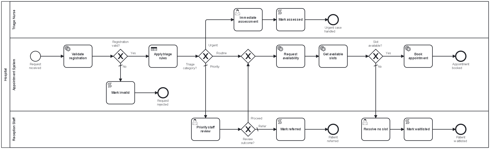
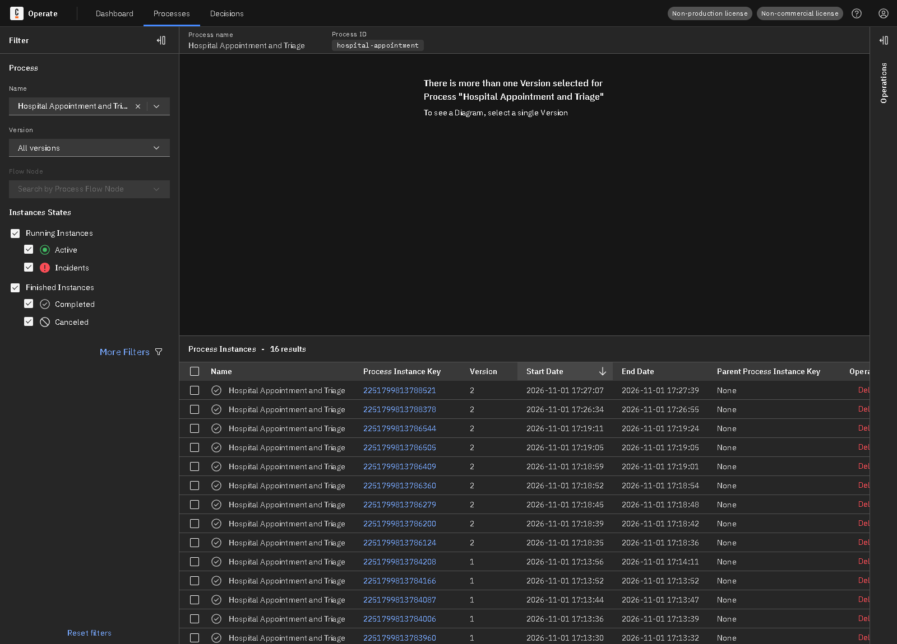
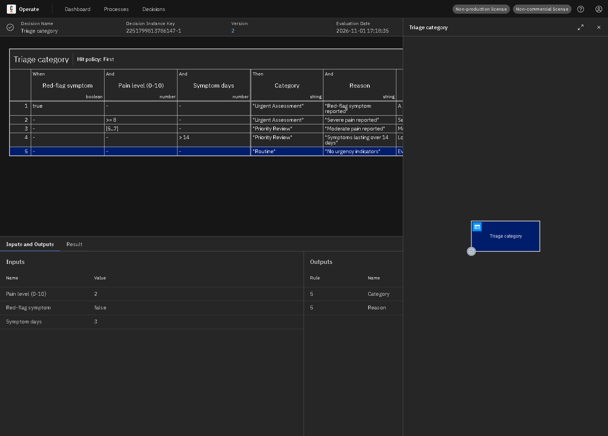
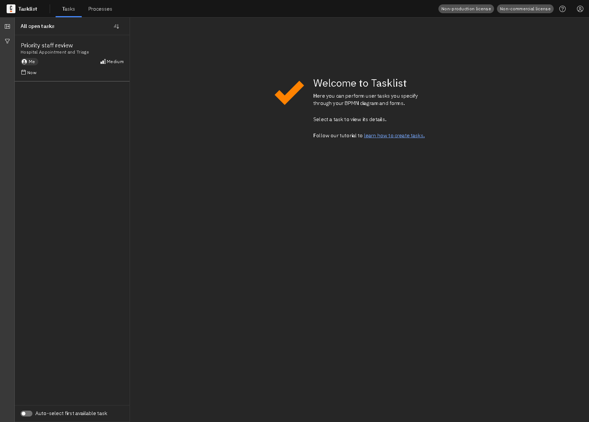
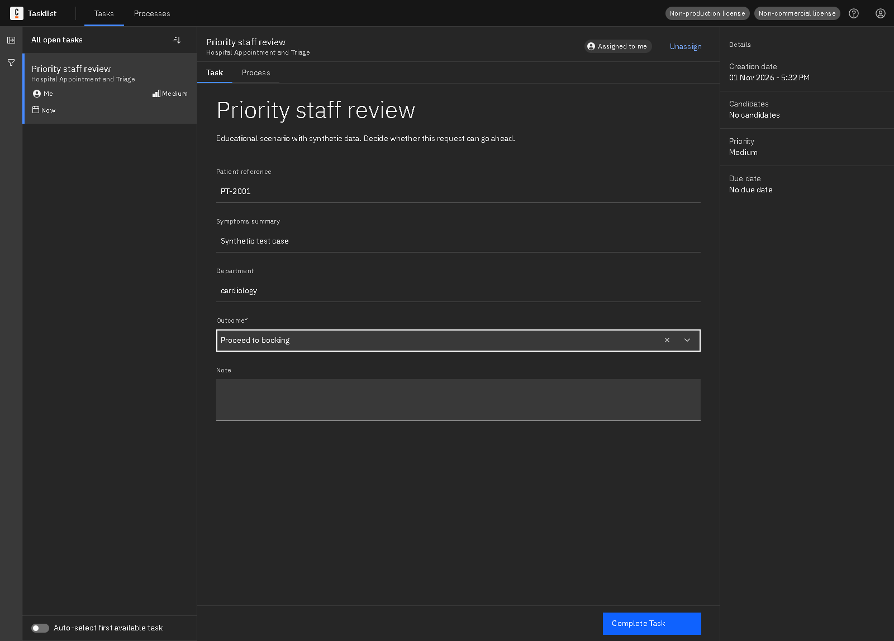
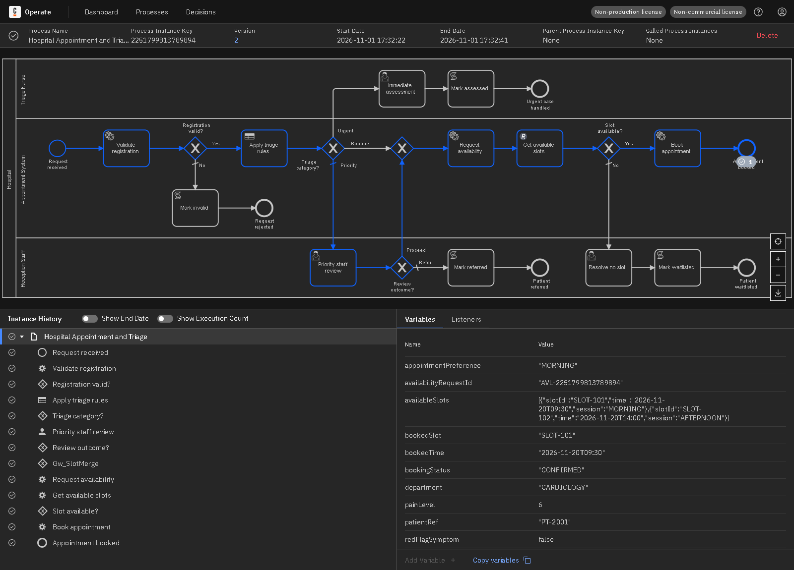
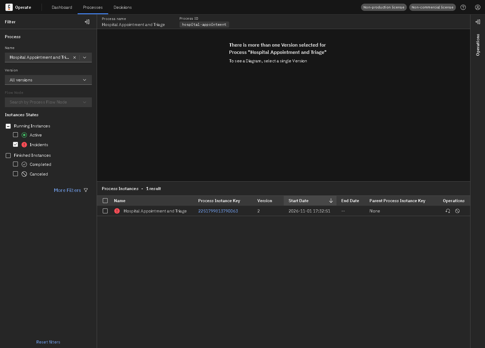
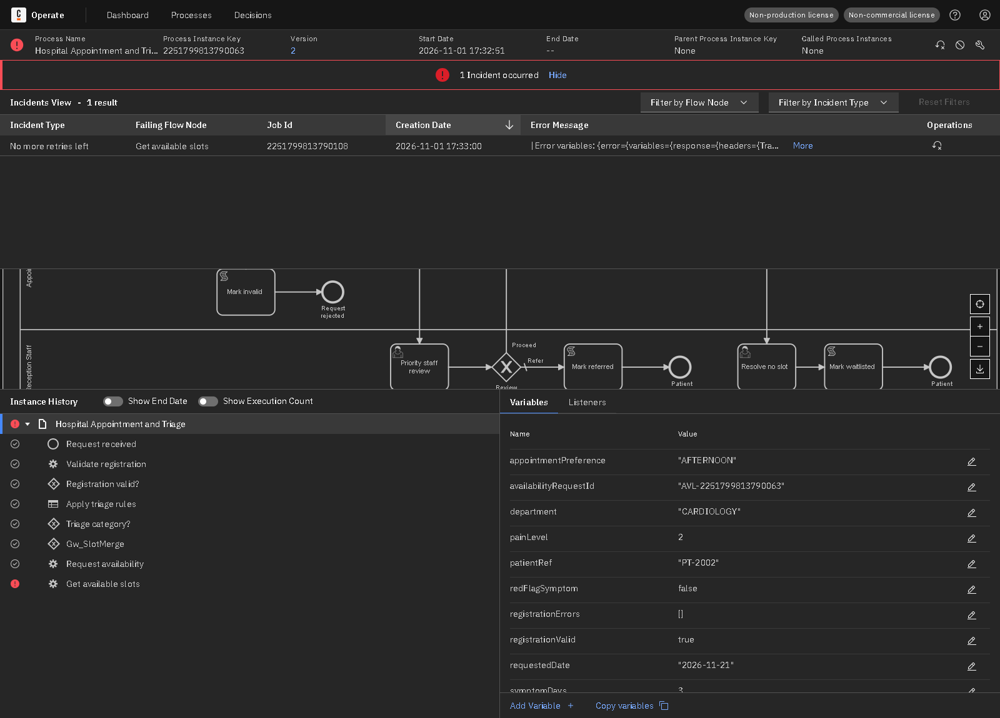
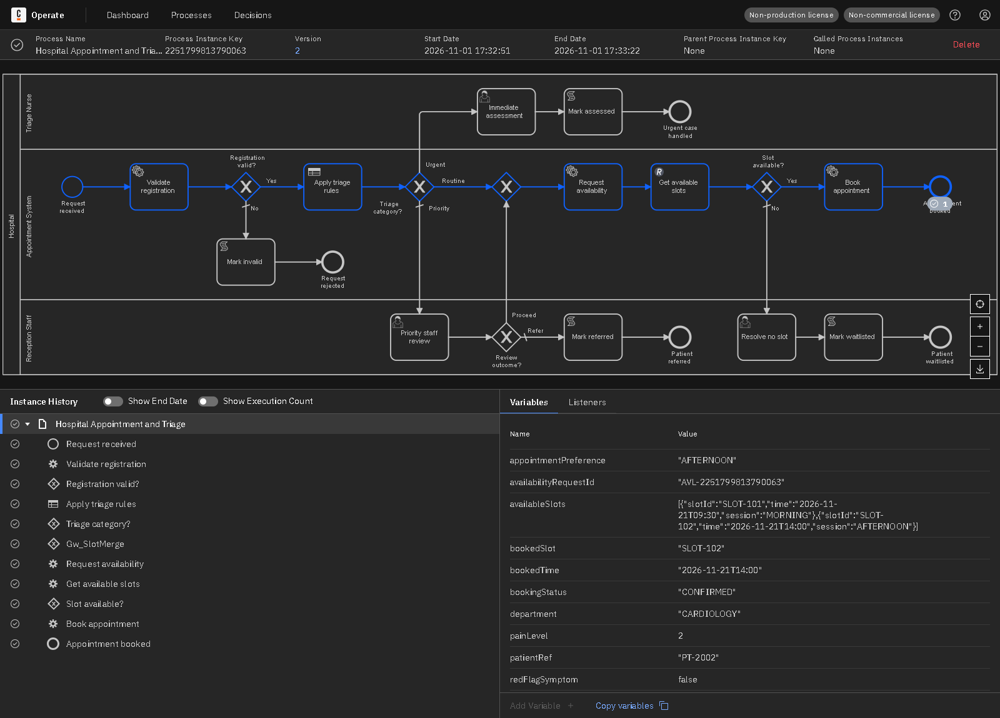

# Lab 3: End-to-End Hospital Appointment and Patient Triage

A synthetic patient request is validated, triaged by a DMN table into Routine, Priority Review or Urgent Assessment, checked for slots through a mock scheduling API, and booked or passed to staff in Tasklist.

## Contents

| Path | What it is |
|---|---|
| `models/hospital-appointment.bpmn` | BPMN process (id `hospital-appointment`) |
| `models/triage-category.dmn` | DMN decision (id `triage-category`) |
| `models/urgent-assessment-form.form` | Form: immediate assessment |
| `models/priority-review-form.form` | Form: priority review |
| `models/no-slot-form.form` | Form: no slot available |
| `worker/` | Spring Boot job worker and mock REST API |
| `api-examples/` | REST request and response samples |
| `tests/scenarios.json` | Test inputs and expected results |
| `evidence/` | Screenshots and recorded test results |

## Architecture

Start → **Validate registration** (job worker) → **Apply triage rules** (DMN) → gateway → Urgent: **Immediate assessment** (Tasklist). Priority: **Priority staff review** (Tasklist). Routine or cleared: **Request availability** (job worker) → **Get available slots** (REST Connector) → **Book appointment** (job worker), or **Resolve no slot** (Tasklist).

| Part | Technology |
|---|---|
| Process engine, Tasklist, Operate | Camunda 8.8 (Camunda 8 Run) |
| Models | BPMN 2.0, DMN and Camunda forms, made for Camunda Modeler |
| External job worker | Java 17+, Spring Boot 3.5, Camunda Spring Boot Starter 8.8 |
| Service integration | REST Connector calling a mock API on port 8103 |



## Gateway routing

| Gateway | Condition | Routing |
|---|---|---|
| Registration valid? | `registrationValid = true` | Yes: triage. No (default): rejected. |
| Triage category? | `triageResult.category` | Routine: check slots. Urgent Assessment: immediate human task. Anything else (default): priority review, so an unexpected result reaches a person. |
| Review outcome? | `reviewOutcome = "PROCEED"` | Proceed: check slots. Otherwise (default): referred. |
| Slot available? | `slotCount > 0` | Yes: book. No (default): staff resolve it. |

## DMN decision

Hit policy **First**: the first matching rule from the top wins. **These rules are invented for this educational scenario and are not clinical guidance.**

| Red-flag symptom | Pain level | Symptom days | Category | Reason |
|---|---|---|---|---|
| true | - | - | Urgent Assessment | Red-flag symptom reported |
| - | >= 8 | - | Urgent Assessment | Severe pain reported |
| - | [5..7] | - | Priority Review | Moderate pain reported |
| - | - | > 14 | Priority Review | Symptoms lasting over 14 days |
| - | - | - | Routine | No urgency indicators |

Sample evaluations, returned by the deployed decision through the Camunda REST API:

| Input | Output |
|---|---|
| redFlagSymptom=true, painLevel=2, symptomDays=1 | category: Urgent Assessment, reason: Red-flag symptom reported |
| redFlagSymptom=false, painLevel=9, symptomDays=1 | category: Urgent Assessment, reason: Severe pain reported |
| redFlagSymptom=false, painLevel=6, symptomDays=2 | category: Priority Review, reason: Moderate pain reported |
| redFlagSymptom=false, painLevel=2, symptomDays=20 | category: Priority Review, reason: Symptoms lasting over 14 days |
| redFlagSymptom=false, painLevel=2, symptomDays=3 | category: Routine, reason: No urgency indicators |

## Job worker

| Job type | BPMN task | What it does |
|---|---|---|
| `lab3.validate-registration` | Validate registration | Checks patient reference format, department, preference, date, symptoms summary and pain level 0-10. |
| `lab3.request-availability` | Request availability | Prepares the availability request: normalises the department and creates a request ID. The REST Connector then makes the call. |
| `lab3.book-appointment` | Book appointment | Books the first slot matching the morning or afternoon preference. |

## REST Connector

`GET http://localhost:8103/api/scheduling/slots?department=...&date=...`, 5 second connect and read timeouts, 3 retries with a 2 second backoff.

| Setting | Value |
|---|---|
| Job type | `io.camunda:http-json:1` (REST Connector) |
| Query parameters | `={department: department, date: requestedDate}` |
| Result expression | `={availableSlots: response.body.slots, slotCount: count(response.body.slots)}` |

An empty slot list is a normal result, so the gateway sends it to staff. An HTTP 503 is a technical failure, so the connector retries and then raises an incident.

Sample responses are in [`api-examples/`](api-examples/README.md).

## Process variables

| Name | Type | Set by | Purpose |
|---|---|---|---|
| patientRef | String | Start | Synthetic patient reference |
| appointmentPreference | String | Start | MORNING or AFTERNOON |
| department | String | Start / worker | Department, upper-cased by the worker |
| requestedDate | String | Start | Requested date |
| symptomsSummary | String | Start | Short synthetic summary |
| redFlagSymptom | Boolean | Start | Urgency indicator, a DMN input |
| painLevel | Number | Start | Pain 0-10, a DMN input |
| symptomDays | Number | Start | Days with symptoms, a DMN input |
| registrationValid | Boolean | Worker | Whether the registration is valid |
| registrationErrors | List | Worker | Validation problems found |
| triageResult | Object | DMN | `category` (urgency category) and `reason` |
| availabilityRequestId | String | Worker | Reference for the slot request |
| availableSlots | List | REST Connector | Slots returned by the API |
| slotCount | Number | REST Connector | Number of slots |
| reviewOutcome | String | Tasklist | PROCEED or REFER |
| reviewNote | String | Tasklist | Staff note |
| assessmentOutcome | String | Tasklist | Result of the urgent assessment |
| noSlotAction | String | Tasklist | What staff chose when no slot was free |
| bookedSlot | String | Worker | Booked slot ID |
| bookedTime | String | Worker | Booked time |
| bookingStatus | String | Worker / script task | Final outcome of the request |

## How to run

1. Start Camunda 8 Run from its install folder: `./c8run start` (on Windows PowerShell: `.\c8run.exe start`)
2. Start the worker and mock API:

   ```bash
   cd lab3-hospital-triage/worker
   ./mvnw spring-boot:run
   ```

   On Windows PowerShell use `.\mvnw.cmd spring-boot:run`.
3. From the repository root, deploy the models and run every scenario:

   ```bash
   node tools/run-scenarios.js lab3-hospital-triage
   ```

To start one instance by hand, deploy the files in `models/` from Camunda Modeler and use these variables:

```json
{
  "patientRef": "PT-1001", "appointmentPreference": "MORNING", "department": "cardiology",
  "requestedDate": "2026-11-20", "symptomsSummary": "Synthetic test case",
  "redFlagSymptom": false, "painLevel": 2, "symptomDays": 3
}
```

Then open <http://localhost:8080/operate> and <http://localhost:8080/tasklist> (login `demo` / `demo`).

## Test results

**7 of 7 scenarios passed** on Camunda 8.8.32, run on 2026-11-01. `DERMATOLOGY` always has no free slots. Every other department has one morning and one afternoon slot. All patients are synthetic, such as `PT-1001`.

| ID | Scenario | Input | Expected route | Expected end | Actual end | Final status | Result |
|---|---|---|---|---|---|---|---|
| TC1 | Routine with a slot | pain 2, cardiology | DMN Routine, slot found, booked | `End_Booked` | `End_Booked` | CONFIRMED | **PASS** |
| TC2 | Priority review, staff proceed | pain 6 | DMN Priority Review, staff proceed, booked | `End_Booked` | `End_Booked` | CONFIRMED | **PASS** |
| TC3 | Priority review, staff refer | 14+ days of symptoms | DMN Priority Review, staff refer | `End_Referred` | `End_Referred` | REFERRED_BY_STAFF | **PASS** |
| TC4 | Urgent assessment | red-flag symptom | DMN Urgent Assessment, immediate human task | `End_Urgent` | `End_Urgent` | URGENT_ASSESSED | **PASS** |
| TC5 | No slots available | dermatology, no slots | No slot, staff task, waitlisted | `End_Waitlisted` | `End_Waitlisted` | WAITLISTED | **PASS** |
| TC6 | Invalid registration | bad patient reference | Validation fails | `End_Invalid` | `End_Invalid` | INVALID_REGISTRATION | **PASS** |
| TC7 | Scheduling API failure and recovery | scheduling outage switched on | Incident, outage fixed, job retried, booked | `End_Booked` | `End_Booked` | CONFIRMED | **PASS** |

Instance details:

| ID | Process instance key | Steps during the run |
|---|---|---|
| TC1 | 2251799813786124 | Ran with no intervention |
| TC2 | 2251799813786200 | Completed task Task_Priority |
| TC3 | 2251799813786279 | Completed task Task_Priority |
| TC4 | 2251799813786360 | Completed task Task_Urgent |
| TC5 | 2251799813786409 | Completed task Task_NoSlot |
| TC6 | 2251799813786505 | Ran with no intervention |
| TC7 | 2251799813786544 | Incident on Task_Slots: \| Error variables: {error={variables={response={headers={Transfer-; Cause fixed, job retried |

## Incident investigation and recovery

1. **Cause.** The `scheduling` outage switch was turned on, so the mock API returned HTTP 503 to **Get available slots**. The connector used up its 3 retries and Camunda raised a *No more retries left* incident.
2. **Diagnosis.** Operate showed the incident on the failing task, with this error: `HTTP 503 from the mock API: "Scheduling service unavailable"`
3. **Fix.** The underlying cause was corrected by turning the outage off:

   `curl -X POST "http://localhost:8103/admin/fault?name=scheduling&down=false"`
4. **Retry.** The job was retried from Operate with **Retry Instance**, and instance `2251799813790063` carried on and completed.

The automated test does the same steps through the Camunda REST API: it updates the job's retries and resolves the incident.

## Evidence

Screenshots come from this implementation running on a local Camunda 8 Run cluster. The Tasklist and incident screenshots use separate runs from the tests in the table above, with instances `2251799813789894` and `2251799813790063`.

**Operate: deployed process and its instances**



**Operate: completed instance with its path, history and variables**


**Operate: DMN evaluation with the matched rule highlighted**



**Tasklist: human task waiting**



**Tasklist: review form filled in**



**Operate: instance finished after the human task**



**Operate: instance with an active incident**



**Operate: incident details and error message**



**Operate: same instance completed after the fix and retry**



## Report

**Implementation.** The process is modelled in BPMN and each kind of work uses a suitable tool: job workers for custom Java logic, DMN for business rules, the REST Connector for the external API, and user tasks for human decisions. Data moves between activities as process variables.

**Failure handling.** Business outcomes, such as a rejected application, are handled by gateways. Technical failures are retried, and then either routed by a boundary event or raised as an incident that can be fixed and retried.

**Results.** All 7 scenarios finished at the expected end event with the expected final status, including the failure and recovery path.

**Limitations.**

- This is a teaching simulation. It must not be used for real triage, and the rules are not clinical advice.
- Slots are generated by the mock and booking does not remove them, so two patients could get the same slot.
- The worker prepares the availability request and the REST Connector makes the actual API call.
- The mock API runs inside the worker app, so it is available only while the worker is running.
- Rules and data are simple and synthetic, made for this lab only.
- No authentication is used, because everything runs locally on Camunda 8 Run.
- Labels in the BPMN file end with a few spaces and an invisible character. This works around a Camunda Modeler 5.50.1 display bug that splits external labels mid-word; it does not change how the process runs.
